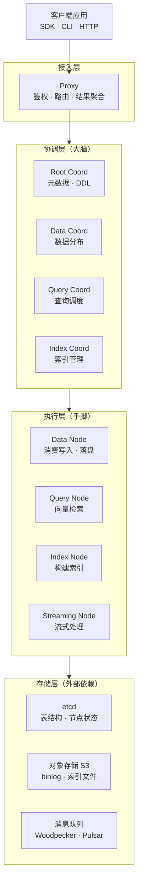
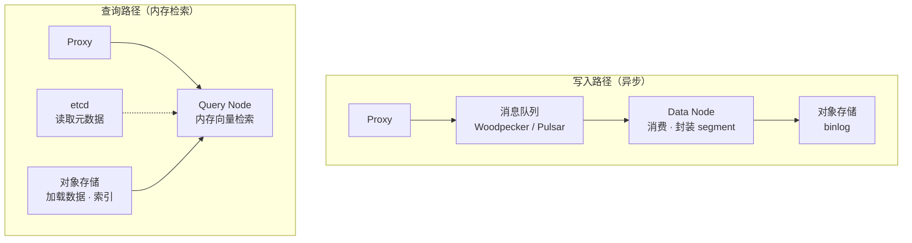

# Milvus on Kubernetes（Milvus Operator + 外部对象存储）

本实例使用 Milvus Operator 在 K8s 上部署 Milvus 集群。对象存储因华为 OceanStor 不支持 Woodpecker 所需条件写，提供两个可选方案（详见"排障"章节）：**方案 A 内置 MinIO + Woodpecker**、**方案 B 外部 OceanStor + Kafka**。文档分两部分：第 1 部分讲架构，第 2 部分讲部署。

相关文件：

| 文件 | 说明 |
|---|---|
| `../../../../../README.md` | 本文档（架构讲解 + 部署步骤） |
| `operator-values.yaml` | Operator Helm 覆盖配置（私有仓库镜像等） |
| `milvus-test-minimal.yaml` | 测试环境资源最小化版（etcd 1 副本 + MinIO standalone） |

## 第一部分：架构讲解

### 1. 核心设计：存算分离

Milvus 是云原生向量数据库，自身不持久保存数据，所有状态外置到三类存储依赖上。因此计算节点无状态、可弹性扩缩容，这也是它能水平扩展到数十亿向量的基础。

### 2. 整体分层架构

从上到下分为五层：接入层、协调层、执行层，以及底层的三类存储依赖。



各组件职责：

- **Proxy**：唯一对客户端暴露的入口（19530 端口），无状态，负责鉴权、请求路由和结果聚合。
- **协调层**：`Root Coord` 管集合/schema 等元数据，`Data Coord` 管数据分布和 segment 状态，`Query Coord` 管查询节点与负载均衡，`Index Coord` 管索引构建。v2.6 起这几个协调器合并为 **Mix Coordinator**，减少组件数量。
- **执行层**：`Data Node` 消费消息队列里的写入并落盘，`Query Node` 常驻内存执行向量检索，`Index Node` 后台构建索引，新版增加 `Streaming Node` 处理流式实时数据。
- **存储层**：etcd（元数据）、对象存储（数据文件）、消息队列（写入日志流），三类缺一不可。

### 3. 写入与查询数据流



- **写入**是异步的：Proxy 收到数据后先写消息队列（保证顺序与持久），Data Node 再消费并批量刷成 binlog 落到对象存储。对象存储的写入是背景流量，不阻塞客户端。
- **查询**走内存：Query Node 把需要的 segment 从对象存储加载进内存做向量检索，etcd 负责告诉它"数据在哪"。对象存储的吞吐和延迟会直接影响首次加载（冷查询）速度。

### 4. 组件与 Pod 对照

部署完成后，`kubectl get pods` 应看到如下组件（以实例名 `my-release` 为例）：

| Pod | 作用 | 提供者 |
|---|---|---|
| `my-release-milvus-proxy` | 唯一入口，19530 端口 | Operator |
| `my-release-milvus-mixcoord` | 合并后的协调器（大脑） | Operator |
| `my-release-milvus-datanode` | 写入落盘 | Operator |
| `my-release-milvus-querynode` | 内存检索 | Operator |
| `my-release-milvus-indexnode` | 构建索引 | Operator |
| `my-release-milvus-streamingnode` | 流式实时数据（新版） | Operator |
| `my-release-etcd-0/1/2` | 元数据 | Operator 内置 |
| `my-release-minio-*` | 对象存储 | 视方案而定 |

对象存储由 `spec.dependencies.storage` 决定：
- `external: true`（原方案）→ 用外部对象存储，**不创建 MinIO Pod**。
- `inCluster`（方案 A）→ Operator 创建 `*-minio-*` Pod，数据存 K8s 内。

其余组件两种方案一致，均照常由 Operator 编排。

## 第二部分：部署

### 1. 前置条件

- K8s 集群已就绪，`kubectl` 可操作集群。
- 已有一个 S3 兼容对象存储（AWS S3 / MinIO / 阿里云 OSS / 腾讯云 COS / Ceph RGW 等），并满足：
  - 有可用的 AK/SK（或 IAM 角色）。
  - 已提前创建好 bucket（Operator 不会自动创建）。
- 已安装 Helm（若选择 Helm 方式安装 Operator）。
- 集群已安装 StorageClass（详见下方"StorageClass 要求"）。

### 2. StorageClass 要求

官方前置条件只要求"集群已安装 StorageClass"。在本实例场景（**外部对象存储 + Woodpecker**）下，需要 PVC 的只有 **etcd**，因此 StorageClass 的要求集中在 etcd 上：

| 要求项 | 说明 |
|---|---|
| 至少有一个可用 SC | 集群需有默认 StorageClass，或在 CR 中显式指定 |
| 访问模式 | etcd 用 `ReadWriteOnce`（RWO），普通块存储即可，不需要 RWX |
| 容量 | etcd 默认每个副本 10Gi，3 副本 = 3 个 PVC（可按需调 `size`） |
| 动态供给 | 需支持动态 PV 创建（`provisioner` 可用），否则 PVC 会 Pending |
| 卷绑定模式 | 推荐 `WaitForFirstConsumer`（多节点/多可用区时避免调度错位） |
| reclaimPolicy | 建议 `Retain`，避免误删实例时丢 etcd 数据 |

**本集群可用**：`longhorn-postgres`（Longhorn，RWO，`WaitForFirstConsumer`，`Retain`，SSD）满足要求；

> 若你的对象存储不是外部的（用 Operator 内置 MinIO），MinIO 也会申请 PVC，此时同样需要 RWO 的 SC。

检查与确认：

```bash
kubectl get sc                        # 查看可用 StorageClass 及 default 标记
kubectl get pvc -A                    # 部署后确认 etcd 的 PVC 已绑定
```

### 3. 准备镜像（使用私有仓库时，本环境必做）

集群节点无法直连 Docker Hub（见下方 DNS 污染说明），因此**必须把所有用到的镜像同步到 harbor**，否则 Pod 会 `ImagePullBackOff`。

#### 完整镜像清单

按所选方案同步镜像（**Woodpecker 是嵌入 Milvus 镜像内的 WAL，无独立镜像**）：

| # | 组件 | 源镜像 | 目标私有镜像 | 适用方案 |
|---|---|---|---|---|
| 1 | Milvus Operator | `milvusdb/milvus-operator:v1.3.7` | `harbor.rd.dsi/docker.io/milvusdb/milvus-operator:v1.3.7` | A / B 都要 |
| 2 | Milvus（所有组件共用） | `milvusdb/milvus:v2.6.4` | `harbor.rd.dsi/docker.io/milvusdb/milvus:v2.6.4` | A / B 都要 |
| 3 | etcd（内置 3 副本） | `milvusdb/etcd:3.5.25-r1` | `harbor.rd.dsi/docker.io/milvusdb/etcd:3.5.25-r1` | A / B 都要 |
| 4 | MinIO（内置对象存储） | `minio/minio:RELEASE.2024-12-18T13-15-44Z` | `harbor.rd.dsi/docker.io/minio/minio:RELEASE.2024-12-18T13-15-44Z` | **仅方案 A** |
| 5 | Kafka + Zookeeper | `bitnami/kafka` 等 | 见方案 B 说明 | **仅方案 B** |

> 版本依据：Operator v1.3.7 官方版本表列出的内置组件版本为 Milvus v2.6.x / etcd 3.5.25 / MinIO RELEASE.2024-12-18T13-15-44Z，其 Makefile 中同步的正是这几个镜像。
>
> 不需要同步的镜像：Woodpecker（内嵌在 Milvus 镜像里）、Pulsar（方案 A/B 都不用）、cert-manager（`enableWebhook: false`）、attu（默认不装）。

#### 同步命令

在一台能联网的机器上用加速器拉取，再 tag/push 到 harbor：

```bash
# ---- 1) Milvus Operator 镜像（helm install 前先备好）----
docker pull docker.m.daocloud.io/milvusdb/milvus-operator:v1.3.7
docker tag docker.m.daocloud.io/milvusdb/milvus-operator:v1.3.7 harbor.rd.dsi/docker.io/milvusdb/milvus-operator:v1.3.7
docker push harbor.rd.dsi/docker.io/milvusdb/milvus-operator:v1.3.7

# ---- 2) Milvus 镜像（创建 CR 前备好）----
docker pull docker.m.daocloud.io/milvusdb/milvus:v2.6.4
docker tag docker.m.daocloud.io/milvusdb/milvus:v2.6.4 harbor.rd.dsi/docker.io/milvusdb/milvus:v2.6.4
docker push harbor.rd.dsi/docker.io/milvusdb/milvus:v2.6.4

# ---- 3) etcd 镜像（创建 CR 前备好）----
docker pull docker.m.daocloud.io/milvusdb/etcd:3.5.25-r1
docker tag docker.m.daocloud.io/milvusdb/etcd:3.5.25-r1 harbor.rd.dsi/docker.io/milvusdb/etcd:3.5.25-r1
docker push harbor.rd.dsi/docker.io/milvusdb/etcd:3.5.25-r1

# ---- 4) MinIO 镜像（仅方案 A：内置 MinIO 需要）----
# 注意：DaoCloud/1ms 等加速器对 minio 热门镜像有限制(denied/403)，
#       实测华为云 SWR 镜像源可用：
docker pull swr.cn-north-4.myhuaweicloud.com/ddn-k8s/docker.io/minio/minio:RELEASE.2024-12-18T13-15-44Z
docker tag swr.cn-north-4.myhuaweicloud.com/ddn-k8s/docker.io/minio/minio:RELEASE.2024-12-18T13-15-44Z harbor.rd.dsi/docker.io/minio/minio:RELEASE.2024-12-18T13-15-44Z
docker push harbor.rd.dsi/docker.io/minio/minio:RELEASE.2024-12-18T13-15-44Z
```

### 4. 安装 Milvus Operator

Helm 方式（推荐）——**带上本目录的 `-f operator-values.yaml`**。由于本环境直连 GitHub 不稳定（helm 直接拉 URL 可能报 `unexpected EOF`），**先本地下载 chart 再安装**：

```bash
# 1) 本地下载 chart 包（用 curl 走系统代理，约 200KB）
curl -sSL --retry 3 -o milvus-operator-1.3.7.tgz \
  https://github.com/zilliztech/milvus-operator/releases/download/v1.3.7/milvus-operator-1.3.7.tgz
tar tzf milvus-operator-1.3.7.tgz >/dev/null && echo "包完整"

# 2) 用本地 tgz 安装
helm install milvus-operator \
  -n milvus-operator --create-namespace \
  --wait --wait-for-jobs \
  -f operator-values.yaml \
  ./milvus-operator-1.3.7.tgz

kubectl get pods -n milvus-operator
```

确认 operator Pod 为 `Running` 后再继续。


### 6. 部署 Milvus 实例

```bash
# 创建命名空间
kubectl create ns milvus

kubectl apply -f milvus-external-s3.yaml 

# 查看状态，status.status 变为 Healthy 即就绪
kubectl get milvus milvus-26 -o yaml -n milvus

# 查看 Pod
kubectl get pods -n milvus
```

### 7. 集群内连接 Milvus

#### 连接信息

| 项目 | 值 |
|---|---|
| 集群内 Service | `milvus-26-milvus.milvus.svc.cluster.local` |
| 端口 | `19530`（gRPC，SDK 用）；`9091`（HTTP 健康检查/metrics） |
| 简写（同 namespace 内） | `milvus-26-milvus:19530` |
| 用户名 / 密码 | **无**（未启用认证，连接时不要传 user/password/token） |

> **认证说明**：当前部署的 `spec.config` 中没有 `common.security.authorizationEnabled: true`，Milvus 认证默认关闭，**不需要任何用户名密码**。若未来开启认证，需配置 `spec.config.common.security.authorizationEnabled: true` 并创建用户（用 pymilvus 的 `client.create_user`），连接时再传 `user`/`password`。

#### 方式一：从集群内 Pod 连接（推荐，无需暴露端口）

在任意一个与 Milvus 同集群的 Pod 里用 Python SDK 连接：

```python
from pymilvus import MilvusClient, connections

# 地址：集群内 Service DNS
uri = "http://127.0.0.1:19530"

# 无认证：不要传 user/password/token
client = MilvusClient(uri=uri)

# 验证：列出 database
print(client.list_databases())
```

临时起一个测试 Pod 验证（用你 harbor 里的 python 镜像）：

```bash
kubectl run milvus-client-test -n milvus --rm -it \
  --image=<你的python镜像含pymilvus> -- bash
# 在 Pod 内执行上面的 Python 代码
```

若镜像没有 pymilvus，先 `pip install pymilvus`（或用能联网的镜像）。

#### 方式二：从集群外连接（port-forward）

```bash
kubectl port-forward --address 0.0.0.0 service/milvus-26-milvus 19530:19530 -n milvus
```

然后本机 SDK 连 `localhost:19530`（同样无用户名密码）：

```python
from pymilvus import MilvusClient
client = MilvusClient(uri="http://localhost:19530")
print(client.list_databases())
```

#### 快速连通性验证（无需 SDK）

```bash
# 在任意 Pod 内测试 19530 端口可达
kubectl exec -it <任意pod> -n milvus -- sh -c 'nc -zv milvus-26-milvus 19530'
# 或测试 HTTP 健康检查端口
kubectl exec -it <任意pod> -n milvus -- sh -c 'curl -s http://milvus-26-milvus:9091/healthz'
```


> 官方建议用 Milvus Sizing Tool 按数据量估算资源：https://milvus.io/tools/sizing


#### 测试环境资源最小化

测试场景可用 `milvus-test-minimal.yaml`，核心手段（参考 Operator 官方 `milvus_minimum.yaml`）：

| 调整项 | 生产默认 | 测试最小化 | 收益 |
|---|---|---|---|
| etcd 副本 | 3 | `replicaCount: 1` | 少 2 个 Pod + 2 块 PVC |
| MinIO 模式 | distributed（4 实例） | `mode: standalone` | 少 3 个 Pod + 3 块 PVC |
| Milvus 全局资源 | 500m/1Gi ~ 2核/4Gi | 100m/256Mi ~ 1核/2Gi | 大幅降低 requests/limits |
| queryNode | 1核/4Gi ~ 4核/16Gi | 100m/512Mi ~ 1核/2Gi | 测试数据量小，够用 |
| etcd 存储 | 10Gi × 3 | 10Gi × 1（**不能写更小**） | 少 2 块 PVC |

> **坑：etcd `persistence.size` 不能小于 10Gi**（首次部署也会中招）。Operator 内嵌 etcd chart 默认 size 是 10Gi，若 CR 写成更小（如 2Gi），Operator 会误判为"缩容"，去找不存在的 `xxx-etcd-old-sts` ControllerRevision 而卡在 Pending（报 `ControllerRevision ... not found`）。**即使全新部署，etcd size 也必须写 10Gi**。实测 Pod 数可从 12 降到 7、PVC 从 7 块降到 2 块（etcd 10Gi + MinIO 5Gi），CR 正常转 Healthy。

**从当前部署切换（会重建依赖，注意数据）**：

```bash
# 1) 删除现有 CR（会触发 etcd/MinIO StatefulSet 重建）
kubectl delete milvus milvus-26 -n milvus
# 若 finalizer 卡住：kubectl patch milvus milvus-26 -n milvus -p '{"metadata":{"finalizers":[]}}' --type=merge

# 2) 清理旧 PVC（关键！否则旧 PVC 残留继续占存储）
# 先看清楚再删——测试环境无重要数据才执行
kubectl get pvc -n milvus
kubectl delete pvc -n milvus \
  data-milvus-26-etcd-0 data-milvus-26-etcd-1 data-milvus-26-etcd-2 \
  export-milvus-26-minio-0 export-milvus-26-minio-1 export-milvus-26-minio-2 export-milvus-26-minio-3

# 3) 应用最小化配置
kubectl apply -f milvus-test-minimal.yaml

# 4) 验证：Pod 数量应明显减少、PVC 只剩 1+1
kubectl get pods -n milvus
kubectl get pvc -n milvus
kubectl top pods -n milvus
```

> 说明：若 Longhorn StorageClass 的 `reclaimPolicy` 是 `Retain`，删 PVC 后底层 PV 可能残留，需在 Longhorn UI 确认并清理；清单里 `pvcDeletion: true` + `deletionPolicy: Delete` 会让 Operator 删除 CR 时一并删其管理的 PVC，但已存在的历史 PVC 建议按上面步骤显式清理。
>
> 最小化配置仅适合测试：**etcd 单副本无高可用、MinIO standalone 无冗余**，生产环境务必用 `milvus-incluster-minio-resources.yaml` 的 3+4 副本配置。

### 9. 外部对象存储配置详解

使用外部已有 S3 时，配置分散在 Milvus CR 的**两个位置**，缺一不可：

```yaml
spec:
  config:
    minio:            # ① 客户端侧：bucket、前缀、签名、协议等
      bucketName: ...
      rootPath: ...
      useSSL: ...
      cloudProvider: ...
      region: ...
  dependencies:
    storage:          # ② 依赖侧：告诉 Operator 用外部存储 + 连接地址与凭据
      external: true
      type: S3
      endpoint: ...
      secretRef: ...
```

> 为什么有两处：`dependencies.storage` 是给 **Operator** 看的（决定要不要部署 MinIO、去哪连）；`config.minio` 是给 **Milvus 进程**内的 S3 客户端看的（决定怎么签名、用哪个 bucket）。Milvus 底层沿用了 `minio` 这个配置键名，即使你用的是 AWS S3 / OSS / COS 也写在这里。

#### 字段详解

| 字段 | 位置 | 必填 | 说明 |
|---|---|---|---|
| `external: true` | storage | 是 | 启用外部对象存储，Operator 跳过内置 MinIO 部署 |
| `type` | storage | 是 | S3 兼容存储统一写 `S3`（外部 MinIO 也写 `S3`） |
| `endpoint` | storage | 是 | `host:port`，**不带** `http://`/`https://`；协议由 `useSSL` 控制 |
| `secretRef` | storage | 是 | 存 AK/SK 的 Secret 名，键名固定 `accesskey` / `secretkey` |
| `bucketName` | minio | 是 | bucket 名，Milvus 只使用单个 bucket |
| `rootPath` | minio | 否 | bucket 内对象前缀，默认 `files`；建议按实例隔离，首次启动后勿改 |
| `useSSL` | minio | 是 | HTTPS=`true`，HTTP=`false`；需与 endpoint 端口匹配 |
| `cloudProvider` | minio | 是 | 签名类型，默认 `aws`；见下表，**AK/SK 场景也必须正确设置** |
| `region` | minio | 视存储 | 签名 v4 场景需要（AWS 必填；自建 MinIO/Ceph 可留空） |
| `useVirtualHost` | minio | 否 | virtual-host style 寻址（bucket 作子域名），bucket not found 时可尝试开启 |
| `useIAM` | minio | 否 | 用 IAM 角色代替 AK/SK（EKS/GKE 场景），本例保持 `false` |

#### cloudProvider 与签名版本（关键）

官方对 `spec.config.minio.cloudProvider` 的定义：

| 值 | 含义 | 适用 |
|---|---|---|
| `aws` | S3 签名 **v4**（默认） | AWS S3、MinIO、Ceph RGW 及多数 S3 兼容存储 |
| `gcp` | S3 签名 **v2** | 支持 v2 签名的兼容存储 |
| `aliyun` | virtual-host style 寻址 | 阿里云 OSS |
| `gcpnative` | 原生 GCS，service account 凭证 | Google Cloud Storage（配合 useIAM） |

> 注意：名称容易误导——`gcp` 这里代表的是 v2 签名，不是"GCS 专用"；原生 GCS 用 `gcpnative`。选错签名版本会报 `SignatureDoesNotMatch`。

### 10. endpoint 与 cloudProvider 对照

| 对象存储 | endpoint（host:port） | useSSL | cloudProvider |
|---|---|---|---|
| 自建 MinIO（HTTP） | `minio.xxx.svc.cluster.local:9000` | false | `aws` |
| 自建 MinIO（HTTPS） | `minio.example.com:443` | true | `aws` |
| AWS S3 | `s3.us-east-1.amazonaws.com:443` | true | `aws`（并设 region） |
| 阿里云 OSS | `oss-cn-hangzhou.aliyuncs.com:443` | true | `aliyun` |
| 腾讯云 COS | `cos.ap-guangzhou.myqcloud.com:443` | true | `aws` |
| Ceph RGW | `<rgw地址>:<端口>` | 视实际 | `aws` |

### 11. 对 S3 bucket 的要求

- **数量**：Milvus 只使用**一个 bucket**（不支持多 bucket 分散存储）。多个 Milvus 实例可共用一个 bucket，但必须用不同 `rootPath` 前缀隔离。
- **命名空间**：bucket 名在该 S3/MinIO 实例内**全局唯一**，不能与已有 bucket 重名冲突。
- **自动创建**：bucket 不存在时，Milvus 启动会**尝试自动创建**；若已存在且可访问则直接使用。因此需要二选一：
  - 提前手工创建好 bucket；或
  - 确保 AK/SK 具备 `s3:CreateBucket` 权限。
- **所需权限**：AK/SK 至少需要对目标 bucket（及其 `rootPath` 前缀）具备：
  `ListBucket`、`GetObject`、`PutObject`、`DeleteObject`；若依赖自动建桶还需 `CreateBucket`。权限不足会在启动时报 AccessDenied。
- **容量**：bucket 需有足够空间存放向量索引、binlog，以及 Woodpecker 的 WAL 日志（WAL 也写在该 bucket）。生产建议预留充足余量并配置容量告警。
- **rootPath 稳定性**：首次启动前确定；运行后修改会导致读不到历史数据。
- **网络可达**：K8s 节点（Pod）必须能访问 `endpoint`——私有集群尤其注意 S3 服务地址、端口放行与 DNS 解析。

### 12. 常见坑

- **useSSL 与端口要匹配**：HTTP 的 MinIO 必须设 `useSSL: false`；endpoint 绝不能写 `http://` 前缀。
- **cloudProvider 选错签名**：OSS 用 `aliyun`、v2 兼容存储用 `gcp`、其余用 `aws`；报错 `SignatureDoesNotMatch` 基本都是这里没对。
- **region 缺失**：AWS S3 等 v4 签名场景需设 `config.minio.region`，否则报签名错误。
- **bucket 权限不足**：Milvus 会尝试建桶/列举对象，AK/SK 权限不足会启动失败；要么授权要么预建 bucket。
- **rootPath 中途修改**：运行后更改会导致读不到历史数据，首次启动前就规划好。
- **Secret 键名固定**：必须是 `accesskey` / `secretkey`（小写、无下划线），写错会导致认证失败。
- **实例名不能含点号（.）**：CR 的 `metadata.name` 只能含小写字母、数字、连字符，且以字母开头/数字结尾。Operator 会用 `<实例名>-etcd` 命名 Service/StatefulSet，若实例名含点号（如 `milvus-2.6`），资源名会变成 `milvus-2.6-etcd`，违反 DNS-1035 规则而创建失败，表现为 CR 一直 `Pending` 且无任何 Pod。改用 `milvus-2-6` 这类连字符命名。
- **PVC 只能扩不能缩**：K8s 不允许缩小 PVC。`persistence.size` 一旦创建就不能改小（如 10Gi → 2Gi），否则报 `spec.resources.requests.storage: Forbidden: field can not be less than status.capacity`，CR 卡在 `Pending`。要调小只能删 CR + 删 PVC 重建（会丢数据）；首次部署就把 size 规划好。

#### 排障：CR Pending 且无任何 Pod

`kubectl apply` 只创建 CR，Pod 由 Operator 调和产生。若 CR 长期 `Pending` 且命名空间无工作负载，按此顺序排查：

```bash
kubectl get milvus -A                          # 1) 确认 CR 存在及 STATUS
kubectl get pods -n milvus-operator            # 2) 确认 Operator 在 Running
kubectl get all -n <实例namespace>             # 3) 看是否真的什么都没建出来
kubectl describe milvus <name> -n <ns>         # 4) 看 Events / Status
kubectl logs -n milvus-operator deploy/milvus-operator --tail=200 | grep -iE "error|invalid"
```

常见错误及处理：

| Operator 日志错误 | 原因 | 处理 |
|---|---|---|
| `metadata.name ... a DNS-1035 label must consist of lower case ...` / `must not contain dots` | **实例名含点号**（如 `milvus-2.6`）导致派生资源名非法 | 删除 CR，改用不含点号的名字重建（如 `milvus-2-6`） |
| `ControllerRevision "xxx-old-sts" not found` | 首次部署时因上一条错误导致 STS 从未建成，PVC 调和逻辑又去找"旧 STS"备份，形成死循环 | 这是次生错误，解决上面的命名问题后自然消失 |
| `spec.resources.requests.storage: Forbidden: field can not be less than status.capacity` | 把 `persistence.size` 改小了（如 10Gi → 2Gi），PVC 不允许缩容 | 改回 >= 当前 PVC 容量；确要调小需删 CR + 删 PVC 重建（丢数据） |
| PVC `Pending` | StorageClass 名写错或 provisioner 异常 | 核对 `spec.dependencies.etcd.inCluster.values.persistence.storageClass` |

> 修复命名后需删除旧 CR 再重建（命名空间为空时可直接删，无数据风险）：
> `kubectl delete milvus <旧名> -n <ns>`，然后修正清单里的 `metadata.name` 重新 apply。

#### 排障：StreamingNode 启动 panic（对象存储不支持条件写）

现象：etcd、S3、各组件都正常连接，但 StreamingNode 启动即崩溃重启，日志中有：

```
panic: CheckIfConditionWriteSupport failed:
PutObjectIfNoneMatch should return error for existing object, but it succeeded unexpectedly
```

**根因**：Milvus 2.6 默认用 **Woodpecker** 作消息队列（WAL），它把日志写在对象存储里，并依赖 S3 的**条件写**（`PUT` 带 `If-None-Match: *` 头）来保证并发写安全。Woodpecker 启动时会做一次强制探测：连写两次同名对象，第二次必须因对象已存在而失败（返回 412 PreconditionFailed）。若你的对象存储**忽略了 `If-None-Match`、第二次直接覆盖成功**，探测判定不支持，直接 panic。这是硬编码断言，**没有配置开关可以跳过**。

这是对象存储兼容性问题，与 Milvus 配置无关。官方兼容矩阵（`storage.type=minio` 场景）：

| 对象存储 | 是否支持 | 说明 |
|---|---|---|
| AWS S3 | 支持 | 原生完整条件写 |
| MinIO >= RELEASE.2024-12-18 | 支持 | 自建 MinIO 必须用此版本或更新 |
| 阿里云 OSS | 支持 | 通过 S3 兼容接口 |
| 腾讯云 COS | 支持 | 通过 S3 兼容接口 |
| GCS | 支持 | S3 互操作模式 |
| Azure Blob | 支持 | 走原生 Azure SDK |
| 华为 OBS | **不支持** | 缺少条件写语义 |
| VAST Data | 部分支持 | 仅非版本化 bucket |
| 其它 S3 兼容存储 | 视情况 | 取决于是否完整实现条件写 |

**解决方案（任选其一）**：

1. **换/升级对象存储**（推荐）：确保它完整支持 `If-None-Match: *` 条件写。自建 MinIO 升级到 `RELEASE.2024-12-18T13-15-44Z` 或更新。可在 Milvus Pod 内用如下方式验证（第二次应报 412）：

   ```bash
   # 在任意 Milvus Pod 内执行，把 endpoint/ak/sk/bucket 换成实际值
   AWS_ACCESS_KEY_ID=<ak> AWS_SECRET_ACCESS_KEY=<sk> aws --endpoint-url http://<endpoint> \
     s3api put-object --bucket <bucket> --key wp-probe --body /etc/hostname --if-none-match '*'
   ```

2. **改用其它消息队列**：若对象存储无法更换（如 OBS 或自建存储不支持条件写），把 `msgStreamType` 从 `woodpecker` 改为 `pulsar` 或 `kafka`，并配置对应依赖。代价是需要额外部署 MQ，但能绕开条件写限制。

3. **Woodpecker 用 local 存储**：仅适合 Standalone 或所有 Pod 共享文件系统（如 NFS）的 Cluster，需给 StreamingNode 配置共享卷，生产较少采用。

> 本机对象存储 `192.168.100.100:5080` 需向存储管理员确认是否支持 `If-None-Match` 条件写；这是能否使用 Woodpecker 的前提。

##### 本环境结论：华为 OceanStor 不支持，改用 Kafka

本环境使用**华为 OceanStor 私有对象存储**。华为 OceanStor Pacific 的对象服务 API 中，`If-None-Match` 只作为 **GET Object 的条件读**请求头定义，`PutObject` 不支持该条件写头——**不满足 Woodpecker 的条件写要求**，实测日志中的 panic 也印证了这一点。因此**本环境必须使用非 Woodpecker 的消息队列**。

已提供 `milvus-external-s3-kafka.yaml`：在 `milvus-external-s3.yaml` 基础上把 `msgStreamType` 从 `woodpecker` 改为 `kafka`，由 Operator 内置部署 Kafka + Zookeeper。切换步骤：

```bash
# 1) 删除卡在 Pending/CrashLoop 的旧 CR（命名空间无业务数据可直接删）
kubectl delete milvus milvus-26 -n milvus

# 2) 确认旧 CR 与 kafka/etcd 残留清理干净（首次失败部署通常无残留）
kubectl get all -n milvus

# 3) 应用 Kafka 版清单（先确认里面 AK/SK、endpoint 占位符已填好）
kubectl apply -f milvus-external-s3-kafka.yaml

# 4) 观察：会依次出现 kafka / zookeeper / etcd / milvus 组件 Pod
kubectl get pods -n milvus -w
kubectl get milvus milvus-26 -n milvus -o jsonpath='{.status.status}'
```

**Kafka 方案新增的镜像与资源**（同样要同步到 harbor，私有集群不通外网）：

| 组件 | 源镜像 | 说明 |
|---|---|---|
| Kafka | `bitnami/kafka:3.1.0-debian-10-r52` | 3 副本 |
| Zookeeper | Kafka chart 内置（bitnami/zookeeper） | 3 副本，随 kafka chart 拉取 |

> 具体镜像 tag 以 Operator 实际报错（`ImagePullBackOff` 事件里显示的镜像名）为准同步。Kafka 还需额外 PVC（清单中 `size: 20Gi`，`storageClass: longhorn-postgres`）。

若集群已有外部 Kafka，可把 `dependencies.kafka.inCluster` 改为 `external: true` 并配置 `brokerList`，省去内置部署。

##### 方案 A：改用内置 MinIO（另一个可行选择）

Operator v1.3.7 内置 MinIO 版本是 `RELEASE.2024-12-18T13-15-44Z`，**正好满足 Woodpecker 的条件写要求**，因此换内置 MinIO 后仍可用 Woodpecker，无需 Kafka。已提供 `milvus-incluster-minio.yaml`。

| 对比项 | 方案 A：内置 MinIO + Woodpecker | 方案 B：OceanStor + Kafka |
|---|---|---|
| 数据存放位置 | K8s 内 MinIO（Longhorn PVC） | 华为 OceanStor（外部，不变） |
| 消息队列 | Woodpecker（内置，无额外 Pod） | Kafka + Zookeeper（多 6 个 Pod） |
| 额外镜像 | MinIO | Kafka + Zookeeper |
| 额外 PVC | MinIO 分布式多副本（较大） | Kafka/ZK 各 3 副本 |
| 组件数量 | 少 | 多 |
| 适用场景 | 接受数据放 K8s 内、追求最少组件 | 数据必须留在 OceanStor（合规/既有数据） |
| 部署清单 | `milvus-incluster-minio.yaml` | `milvus-external-s3-kafka.yaml` |

**如何选**：
- 若 OceanStor 上的数据没有强绑定要求（没有历史数据要复用、无合规要求），**方案 A 更简单**：组件少、少一套 MQ、官方默认路径，排障更容易。
- 若必须用 OceanStor（已有数据、统一存储策略、容量已规划），选**方案 B**。

切换方案 A：

```bash
kubectl delete milvus milvus-26 -n milvus
kubectl apply -f milvus-incluster-minio.yaml
kubectl get pods -n milvus -w       # 会出现 minio / etcd / milvus 组件
```

> 注意：方案 A 会创建新的 MinIO 实例和 PVC，**与之前的 OceanStor 数据是两套 independent 存储**——切换不会迁移已有数据。首次部署无数据则无影响。

### 13. 卸载

```bash
kubectl delete milvus my-release
# 若通过 Helm 安装 Operator
helm -n milvus-operator uninstall milvus-operator
# 若通过 kubectl 安装 Operator
kubectl delete -f https://raw.githubusercontent.com/zilliztech/milvus-operator/v1.3.7/deploy/manifests/deployment.yaml
```

### 参考

- 官方部署文档：https://milvus.io/docs/zh/install_cluster-milvusoperator.md
- Operator 外部对象存储配置：https://milvus-io.github.io/milvus-operator/docs/administration/manage-dependencies/object-storage.html