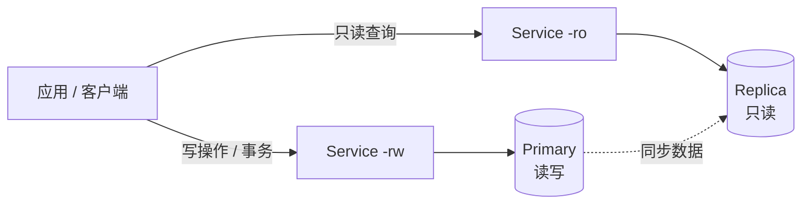

# Postgres On Kubernetes

## 一、 准备镜像

```bash
docker pull ghcr.io/cloudnative-pg/cloudnative-pg:1.29.2
docker tag ghcr.io/cloudnative-pg/cloudnative-pg:1.29.2 harbor.rd.dsi/ghcr.io/cloudnative-pg/cloudnative-pg:1.29.2
docker pull ghcr.io/cloudnative-pg/postgresql:14.25-standard-bookworm
docker tag  ghcr.io/cloudnative-pg/postgresql:14.25-standard-bookworm \
            harbor.rd.dsi/ghcr.io/cloudnative-pg/postgresql:14.25-standard-bookworm
docker push harbor.rd.dsi/ghcr.io/cloudnative-pg/postgresql:14.25-standard-bookworm
```

## 二、安装 cnpg operator 

### 2.1 添加helm源

```bash
helm repo add cnpg https://cloudnative-pg.github.io/charts
helm repo update

# 查看版本
helm search repo cnpg/cloudnative-pg --versions
#
```

### 2.2 安装operator

```bash

helm upgrade --install cnpg \
  --namespace cnpg-system \
  --create-namespace \
  --version 0.28.3 \
  -f cloudnative-pg-values.yaml \
  --force \
  --wait \
  cnpg/cloudnative-pg
 
kubectl apply -f rbac.yaml
```

```bash
kubectl -n cnpg-system get deploy
kubectl -n cnpg-system rollout status deploy/cnpg-cloudnative-pg
```

## 三、部署P `Postgres` 数据库

### 3.1 创建命名空间

```bash
kubectl create ns postgres
```


### 3.2 创建 postgres 14 数据库集群


```bash
# 创建数据库管理员秘钥
kubectl apply -f 14/dbadmin-secret.yaml
# 部署 postgresql 集群
kubectl apply -f 14/postgres-14.yaml
```

## 四、访问与连接

### 4.1 Service 端点

Operator 自动生成三个 ClusterIP Service：

| Service | 指向 | 用途 |
|---------|------|------|
| `postgres-14-cluster-rw` | 当前主库 | 读写流量（写必须走这里） |
| `postgres-14-cluster-ro` | 从库 | 只读查询，可分担主库压力 |
| `postgres-14-cluster-r` | 所有实例 | 直连各实例（运维/排障用） |



### 4.2 获取凭据

```bash
# dbadmin 密码（本目录 Secret，注意名称是 dbadmin-pg-14）
kubectl -n postgres get secret dbadmin-pg-14 \
  -o jsonpath='{.data.password}' | base64 -d; echo

# 内置超管用户名 / 密码
kubectl -n postgres get secret postgres-14-cluster-superuser \
  -o jsonpath='{.data.username}' | base64 -d; echo
kubectl -n postgres get secret postgres-14-cluster-superuser \
  -o jsonpath='{.data.password}' | base64 -d; echo
```

> `kubernetes.io/basic-auth` 类型 Secret 的用户名也可从 `.data.username` 读取；若清单里只设了 `password`，则用户名固定为 `dbadmin`。

### 4.3 连接数据库

```bash
# 方式一：从集群内临时 Pod 连接（推荐用于验证）
kubectl -n postgres run psql-test --rm -it \
  --image=harbor.rd.dsi/ghcr.io/cloudnative-pg/postgresql:14.25-standard-bookworm -- \
  psql -h postgres-14-cluster-rw.postgres.svc.cluster.local \
       -U dbadmin -d app

# 方式二：端口转发到本地
kubectl -n postgres port-forward svc/postgres-14-cluster-rw 5432:5432
# 另开终端：psql -h localhost -p 5432 -U dbadmin -d app
```

> 连接时按提示输入 Secret 中的密码。应用连接串示例：
> `postgresql://dbadmin:<密码>@postgres-14-cluster-rw.postgres.svc.cluster.local:5432/app`
