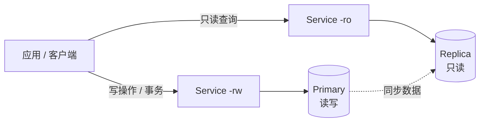

# Postgres On Kubernetes

## 前置依赖 

已经部署 cnpg-operator

## 一、 准备镜像

```bash
docker pull ghcr.io/cloudnative-pg/postgresql:14.25-standard-bookworm
docker tag  ghcr.io/cloudnative-pg/postgresql:14.25-standard-bookworm \
            harbor.rd.dsi/ghcr.io/cloudnative-pg/postgresql:14.25-standard-bookworm
docker push harbor.rd.dsi/ghcr.io/cloudnative-pg/postgresql:14.25-standard-bookworm
```

## 二、部署P `Postgres` 数据库

### 2.1 创建命名空间

```bash
kubectl create ns postgres
```

### 2.2 创建 postgres 数据库服务

* 数据库与用户均为 `smarttitu_assistant`

```bash
# 创建数据库管理员秘钥
kubectl apply -f 01-postgres-secret.yaml
# 部署 postgresql 集群
kubectl apply -f 02-postgres-14.yaml
```

## 三、访问与连接

### 3.1 Service 端点

Operator 自动生成三个 ClusterIP Service：

| Service | 指向 | 用途 |
|---------|------|------|
| `postgres-14-cluster-rw` | 当前主库 | 读写流量（写必须走这里） |
| `postgres-14-cluster-ro` | 从库 | 只读查询，可分担主库压力 |
| `postgres-14-cluster-r` | 所有实例 | 直连各实例（运维/排障用） |



### 3.2 获取凭据

```bash
# smarttitu_assistant 密码（本目录 Secret，注意名称是 dbadmin-pg-14）
kubectl -n postgres get secret dbadmin-pg-14 \
  -o jsonpath='{.data.password}' | base64 -d; echo

# 内置超管用户名 / 密码
kubectl -n postgres get secret postgres-14-cluster-superuser \
  -o jsonpath='{.data.username}' | base64 -d; echo
kubectl -n postgres get secret postgres-14-cluster-superuser \
  -o jsonpath='{.data.password}' | base64 -d; echo
```

> `kubernetes.io/basic-auth` 类型 Secret 的用户名也可从 `.data.username` 读取；若清单里只设了 `password`，则用户名固定为 `dbadmin`。

### 4.3 连接数据库

```bash
# 创建常驻 Pod（不自动删除）
kubectl -n postgres run psql-test \
  --image=harbor.rd.dsi/ghcr.io/cloudnative-pg/postgresql:14.25-standard-bookworm \
  --restart=Never --command -- sleep infinity

# 进入 Pod
kubectl -n postgres exec -it psql-test -- bash

# 交互式输入密码，避免明文进 shell 历史
read -rsp 'Password: ' PGPASSWORD && export PGPASSWORD && echo

psql -h postgres-14-cluster-rw.postgres.svc.cluster.local \
     -p 5432 \
     -U smarttitu_assistant \
     -d smarttitu_assistant


# 方式二：端口转发到本地
kubectl -n postgres port-forward svc/postgres-14-cluster-rw 5432:5432
# 另开终端：
psql -h localhost -p 5432 -U smarttitu_assistant -d smarttitu_assistant
```

> 连接时按提示输入 Secret 中的密码。应用连接串示例：
> `postgresql://smarttitu_assistant:<密码>@postgres-14-cluster-rw.postgres.svc.cluster.local:5432/smarttitu_assistant`
