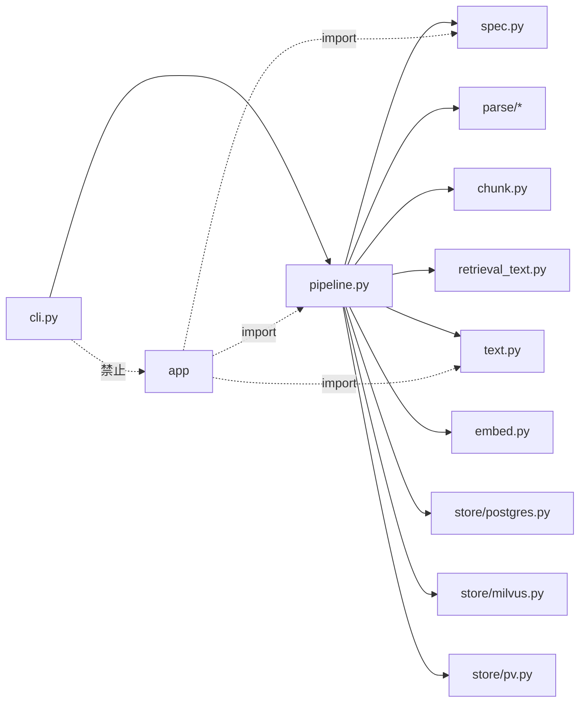
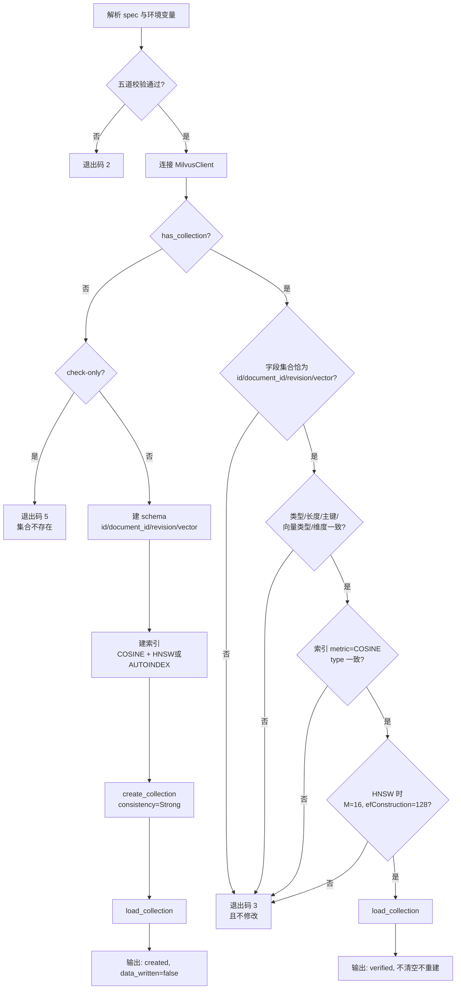
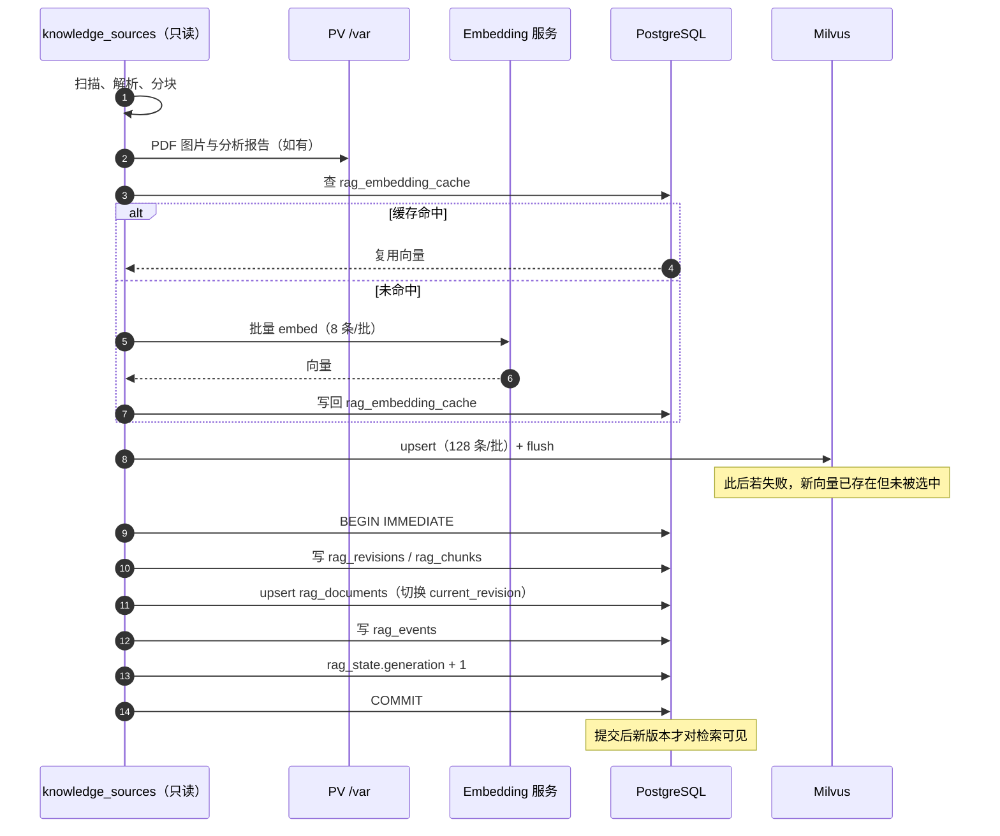
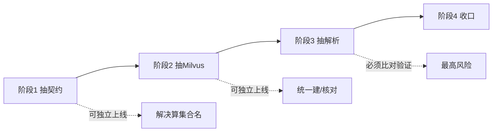

# 知识向量化模块技术方案

> **文档定位**：知识向量化模块（`knowledge_pipeline`）的设计与实施方案，覆盖 Milvus 集合初始化、知识入库、集合名解耦、向量化链路的 app 依赖治理四部分。
> **整合来源**：`Milvus初始化与知识入库说明.md`、`Milvus集合名解耦分析.md`、`向量化链路app依赖清单.md`。三份原文的分析结论已全部收敛到本文，本文是唯一执行口径。
> **读者**：后端研发、部署/运维。
> **状态**：设计已定，分阶段实施；迁移期现有链路保持可用。

## 术语与口径

| 术语 | 含义 |
|---|---|
| 知识向量化模块 / pipeline | 待建的独立 Python 包 `knowledge_pipeline`，唯一负责"文档 → 切片 → 向量 → 三处落盘" |
| 向量化链路 | 扫描知识源、解析、切分、Embedding、写 Milvus / PostgreSQL / PV 的完整过程 |
| 集合命名契约 | `集合名 = 前缀 + "_" + fingerprint[:16]` |
| fingerprint（指纹） | 由 8 项输入（2 个代码常量 + 6 个配置）计算的 sha256，唯一决定集合名 |
| 三处落盘 | Milvus（向量索引）、PostgreSQL（权威元数据与原文）、PV（PDF 媒体等非结构化产物） |
| 严格核对 | 字段集合、类型、长度、主键、维度、metric、索引类型与 HNSW 参数逐项比对，只报错不修复 |
| 只读核对 | `--check-only`：集合不存在即失败，全程不写入 |
| 入库 / ingest | 把知识源写入三处存储的动作，分增量与全量重建两种模式 |
| app | 在线服务 `app/`，只负责检索、会话与 API |

正文统一用"集合"，代码符号、命令行参数与 Milvus 官方术语中的 `collection` 保留英文。

---

## 0. 方案摘要

新建独立 Python 包 `knowledge_pipeline`，把"文档 → 切片 → 向量 → 三处落盘"整条链路从 `app` 中抽出，`app` 反向依赖它。

```text
现状（信息反向依赖）                    目标（依赖方向反转）
┌──────────────┐  ┌──────────────┐     ┌──────────────┐  ┌──────────────┐
│ 02_milvus.py │  │ manage.py    │     │ pipeline CLI │  │  app/server  │
│ （独立脚本）  │  │ ingest       │     │              │  │              │
└──────┬───────┘  └──────┬───────┘     └──────┬───────┘  └──────┬───────┘
       │ 参数要 app 算    │ import app          │ import          │ import
       └────────┬─────────┘                     └────────┬────────┘
                ▼                                        ▼
         ┌──────────────┐                        ┌────────────────────┐
         │     app      │                        │ knowledge_pipeline │
         └──────────────┘                        └────────────────────┘
```

三句话概括：

1. **一个包**：`knowledge_pipeline` 定义规格、解析、切分、向量化、三处写入。
2. **一个契约**：`VectorizationSpec`（含 fingerprint 与集合名），序列化为 `vector-spec.json`，是模块与 app 之间唯一的事实来源。
3. **一个入口**：`python -m knowledge_pipeline {init|ingest|verify|status|export-spec}`，全量重建用 `ingest --rebuild`，`manage.py ingest` 退化为薄 shim。

范围边界：

| 属于本模块 | 不属于本模块 |
|---|---|
| 规格与 fingerprint、集合名推导 | 检索链路（query → 向量 → 搜索 → 重排） |
| 文档解析、切分、检索文本构造 | 会话、工作流、HTTP API |
| Embedding 调用与归一化 | `rag_*` 表结构变更 |
| Milvus 集合建/核对/写入 | 集合名可读化（显式命名，见 §8） |
| PostgreSQL `rag_*` 读写、PV PDF 媒体落盘 | 前端与评测业务逻辑 |

---

## 1. 现状

### 1.1 一条链路，三个存储

`ingest` 不是"写一个地方"，它同时牵动三类存储，且每类存的东西完全不同。

```text
                         ┌──────────────────────────┐
                         │   manage.py ingest       │
                         └────────────┬─────────────┘
                                      │
        ┌─────────────────────────────┼─────────────────────────────┐
        │                             │                             │
        ▼                             ▼                             ▼
┌───────────────┐           ┌──────────────────┐          ┌──────────────────┐
│  PV 目录       │           │  PostgreSQL      │          │  Milvus          │
│ /srv/assistant │           │  knowledge schema│          │  集合             │
│   /var        │           │                  │          │                  │
├───────────────┤           ├──────────────────┤          ├──────────────────┤
│ PDF 图片       │           │ 6 张 rag_* 表     │          │ 4 个字段          │
│ PDF 分析报告   │           │ 原文 / 切片 / 元数据│         │ 向量 + 归属       │
│ （SQLite 回退）│           │ 向量缓存          │          │                  │
└───────────────┘           └──────────────────┘          └──────────────────┘
     非结构化                   结构化 + 权威                 ANN 检索索引
```

§6.2 给出逐表、逐路径的写入清单。这里只需记住一条判断：**Milvus 可重建，PG 不能**，因此备份优先级是 PG > PV > Milvus。

### 1.2 现有入口与职责

部署期和运行期各有一套入口，彼此没有代码依赖，只靠集合命名契约对齐。

| 维度 | `02_milvus.py` | `manage.py` |
|---|---|---|
| 性质 | 部署期可重入的集合建管脚本（71 行） | 全应用运维 CLI，覆盖配置、鉴权、知识、向量、诊断、评测、运维七类命令 |
| 是否进运行镜像 | **否** | **是**，复制为 `/srv/assistant/manage.py` |
| 是否依赖 `app/` 代码 | 否，仅标准库 + `pymilvus` | 是，大量懒加载 `app.*` |
| 是否调用 Embedding | 否 | `ingest` 会；`sync-vectors` 不会 |
| 是否写知识数据 | 否 | 是（`rag_*` 表 + Milvus 向量） |
| 失败时的副作用 | 无（存在则只读核对，不符即退出） | `ingest` 先写向量后写关系指针，失败保留旧版本 |
| 典型使用者 | 交付/实施、DBA 式核对 | 研发、运维、CI/Job |

`manage.py` 放在 `database/milvus/` 目录下，但它**不是 Milvus 专用工具**。与向量化相关的只有 5 条路径：

| 命令 | 与 Milvus 的关系 |
|---|---|
| `ingest` | **写入向量**，内部 `ensure()` 自动建集合 |
| `vector-init` | **建集合 / 严格核对**，不写数据、不调模型 |
| `sync-vectors` | **只搬向量**，不调模型 |
| `doctor` | 检查集合是否存在 |
| `activate` | 切换修订版本，需同步 Milvus |

`manage.py` 的两个设计点值得保留到 pipeline CLI：`init` 之前不构造 `Settings`（否则缺 `AUTH_SECRET` 时无法初始化）；`app.*` 一律懒加载（否则 `--help` 也会连库、加载模型依赖）。

**当前部署形态（过渡态）**：Milvus 任务复用 assistant 镜像，以独立 Job `titu-milvus-init` 执行，不参与 App 启动流程。Job 内由 `database/milvus/knowledge-init.sh` 串行完成"算集合名 → 集合建/核对 → `manage.py ingest` → `doctor --models`"，任一步失败即退出；`manage.py vector-init --check-only` 保留为手工巡检入口。具体命令以 `deploy/k8s/dev/50-job-milvus-init.yaml` 为准。这是本方案阶段 1–2 的落点，目标态由 §7 的 CLI 取代。

### 1.3 两个硬问题

| 问题 | 表现 | 后果 |
|---|---|---|
| 信息反向依赖 | 建集合前必须跑 app 代码算集合名 | 运维要在容器里 `python -c` 拼字符串，抄错就建出一个空集合，入库"看似成功但检索为空" |
| 能力分散 | 建集合在 `02_milvus.py`，灌数据在 `manage.py`，核对只存在于脚本里 | 同一份集合定义有三处实现（脚本、`vector-init`、`ensure`），核对强度不一致 |

`02_milvus.py` 的"独立性"是表面的：它确实不 `import app`，但核心参数 `--collection` 必须由 app 的代码常量参与计算。只要 fingerprint 里含 `PIPELINE_VERSION`、`TEXT_VERSION` 这两个**代码里的常量**，就必然依赖某个版本的 app。

所以真正的问题不是"让脚本不依赖 app"，而是：**让集合名成为一个可以被独立传递的值，而不是每次现算。**

### 1.4 三层耦合

```text
┌─────────────────────────────────────────────────────────────────┐
│ 第 3 层：流程耦合                                                │
│   算名字要进 assistant 镜像；建集合要跑 02_milvus.py            │
│   两个镜像、两个环境，中间靠人抄一次字符串                       │
├─────────────────────────────────────────────────────────────────┤
│ 第 2 层：信息耦合                                                │
│   collection = 前缀 + "_" + sha256([...])[:16]                   │
│   8 个输入里 6 个来自环境变量，2 个来自代码常量                   │
├─────────────────────────────────────────────────────────────────┤
│ 第 1 层：代码耦合（已解）                                        │
│   02_milvus.py 只 import argparse / os / re                      │
└─────────────────────────────────────────────────────────────────┘
```

第 1 层已解决，第 2 层是根本，第 3 层是它带来的运维负担。三层各自怎么解，见 §2.4 与 §8。

### 1.5 为什么这两个常量不能外置

fingerprint 的 8 项输入中，6 项来自环境变量，2 项是代码常量：

```python
# app/rag.py
data = [
    PIPELINE_VERSION,      # 'documents-v2'      ← app/ingestion.py:11  代码常量
    TEXT_VERSION,          # 'retrieval-text-v2' ← app/retrieval.py:7   代码常量
    embedding_provider,    # 环境变量
    embedding_url,         # 环境变量
    embedding_model,       # 环境变量
    embedding_revision,    # 环境变量
    chunk_chars,           # 代码默认 1000
    overlap_chars,         # 代码默认 100
]
fingerprint = sha256(json.dumps(data)).hexdigest()
```

这两个常量是**故意的代码常量**：

```text
解析逻辑改了（比如 PDF 分块方式变化）
    → 开发者 bump PIPELINE_VERSION
    → fingerprint 自动变
    → 集合名自动变
    → 新旧切片天然隔离
```

如果改成 `os.getenv('PIPELINE_VERSION', 'documents-v2')`：

```text
升级镜像
    → 忘了改环境变量
    → fingerprint 不变、集合名不变
    → 新切片和旧索引混在一起
    → 检索结果悄悄变差，且极难定位
```

**外部化等于把"自动安全"换成"依赖人的记性"。** 这是很多解耦方案看起来可行、实际会埋雷的地方。正确的解法不是外置，而是把这两个常量连同算法一起搬进 `spec.py`，让 app 反向引用（§2.5）。

---

## 2. 目标与设计原则

### 2.1 目标形态

```text
部署期                                运行期
┌────────────────────────┐            ┌────────────────────────┐
│ pipeline CLI           │            │ app/server             │
│  init / ingest         │            │  检索：query→搜索→重排  │
│  verify / status       │            │  启动：校验 spec        │
└───────────┬────────────┘            └───────────┬────────────┘
            │                                     │
            └──────────────┬──────────────────────┘
                           ▼
                ┌─────────────────────┐
                │ knowledge_pipeline  │  ← 唯一的向量化实现
                │  spec / parse       │
                │  embed / store      │
                └──────────┬──────────┘
                           │
        ┌──────────────────┼──────────────────┐
        ▼                  ▼                  ▼
   PostgreSQL           Milvus              PV
   元数据+原文          向量集合            PDF 媒体
```

一句话：**算法只有一份，入口只有一个，app 只负责检索。**

### 2.2 不可违反的约束

以下四条是数据兼容的底线，任何阶段都不得破坏：

1. **fingerprint 必须 bit-for-bit 不变**，否则集合名改变，全部知识需重新 Embedding。
2. **`rag_*` 表结构不变**，本次不引入任何数据库迁移。
3. **`document_id` / `revision` / `chunk_id` 算法不变**，否则历史修订全部失效。
4. **现有调用链路可用**：K8s Job、`manage.py ingest`、运维脚本在迁移期不能断。

### 2.3 不做什么

- 不改检索链路（`SemanticKnowledge.assess`、rerank、会话）——那是 app 的职责。
- 不改数据库 schema。
- 不做集合名可读化（显式命名，S3）——与本次解耦正交，且会移除 fingerprint 的自动隔离，见 §8.4。
- 不新建 `knowledge-tools` 独立镜像——当前复用 assistant 镜像，减少移动部件。

### 2.4 解耦的三层含义

```text
① 部署解耦（独立镜像 / 独立 Job / 独立权限）      ✅ 值得做，属于标准实践
② 依赖单向（app → pipeline，pipeline 不反向依赖）  ✅ 本方案目标
③ 代码零依赖（两边互不引用）                        ❌ 不可能，共享内核必须复用
```

- **①** 是"批处理与在线服务分离"的常规做法（CQRS 的写侧分离、ETL 与 OLTP 分离），收益明确：长任务不占 API 容器、可独立扩缩、故障不互相拖垮。
- **②** 是可落地的最优边界：算法只有一份，谁都不抄。
- **③** 是误解。真正的类比是"数据库驱动"——应用和批处理都用它，不是"两边互不依赖"，而是"都依赖同一个底层"。

**结论："ingest 与 app 彻底解耦"符合最佳实践，前提是把"解耦"理解为 ①+②，而不是 ③。**

如果按 ③ 强行实施，只有两种结局：

| 做法 | 后果 |
|---|---|
| 复制 `retrieval_text` / `terms` 到两边 | 行为漂移，检索质量悄悄下降（最坏的一种） |
| 把共享内核拆成"入库版"和"检索版" | 语义分裂，`retrieval_text` 与 query 处理不再匹配 |

这两种都比"共享一个内核"更糟。共享内核的证据是直接的：

```python
# app/rag.py:353 —— rerank 时把候选文档转成文本，用的是同一个 retrieval_text
order = self.reranker.rank(question, [retrieval_text(s['row']) for s in candidates])

# app/retrieval.py:87-91 —— lexical ranking 对 query 和文档做同一套分词
query = set(terms(lexical_query(question)))
counts = [Counter(terms(title_text(row['title'])) * 3 + terms(clean_content(row['content']))) ...]
```

含义很明确：**如果入库用一份 `retrieval_text`、检索用另一份，哪怕只差一个换行，rerank 的输入分布就变了，评分不再可比，检索质量下降但不会报错。**

### 2.5 依赖方向反转，而不是"复制一份"

```text
❌ 错误做法：把 fingerprint 算法复制进独立模块
   → 两份实现，版本漂移，静默出错

✅ 正确做法：算法只有一份，放在模块里；app 改为 import 模块
   → 谁都不用抄，也不存在两边不一致
```

同理适用于 `retrieval_text`、`terms`、`EmbeddingClient`、`normalized_vector` 等共享内核。判定标准（三条全满足才算彻底解耦）：

```bash
# 1. 新包内无任何 app 引用
grep -rn "from app\|import app" knowledge_pipeline/     # 必须为空

# 2. 新包可独立安装运行
pip install knowledge_pipeline && python -m knowledge_pipeline status

# 3. 依赖方向单向
pip show knowledge_pipeline        # 不依赖 app
pip show titu-assistant            # 依赖 knowledge_pipeline
```

### 2.6 边界按"数据流阶段"切

| 阶段 | 归属 | 理由 |
|---|---|---|
| 读文档、解析、切分 | pipeline | 决定 fingerprint 与 chunk 内容 |
| 调 Embedding | pipeline | 决定向量 |
| 写 Milvus / PG / PV | pipeline | 三处落盘必须在一个编排里 |
| 检索（query → 向量 → 搜索 → 重排） | app | 面向请求，有超时与降级 |
| 会话、工作流、API | app | 与知识无关 |

### 2.7 强制单向依赖

用 `import-linter` 或 CI 静态检查兜底：

```bash
grep -rn "^from app\|^import app" knowledge_pipeline/ && exit 1
```

`app` 可以 import `knowledge_pipeline`，反向禁止。每一层抽完后都跑一次，确保零引用。

---

## 3. 模块结构

### 3.1 目录

```text
knowledge_pipeline/
├── pyproject.toml                    # 独立可安装；不依赖 app
├── README.md
├── src/knowledge_pipeline/
│   ├── __init__.py                   # 导出 VectorizationSpec、Pipeline
│   ├── spec.py                       # 规格定义 + fingerprint + 序列化
│   ├── errors.py                     # 统一异常（SpecError / ParseError / StoreError）
│   ├── parse/
│   │   ├── __init__.py               # parse_document 分发
│   │   ├── base.py                   # Parsed / Chunk 数据结构、SUPPORTED
│   │   ├── docx.py
│   │   ├── pdf.py                    # 文本抽取
│   │   ├── pdf_topics.py             # PDF 主题与富化
│   │   ├── markdown.py
│   │   └── text.py
│   ├── chunk.py                      # 按字符切分 + 重叠
│   ├── text.py                       # terms / clean_content / title_text（共享原语）
│   ├── retrieval_text.py             # TEXT_VERSION 与检索文本构造
│   ├── embed.py                      # Embedding 客户端（ollama / openai）
│   ├── media_catalog.py              # 图片 ID 登记校验（从 conversation 抽出）
│   ├── _deadlines.py                 # 超时控制（复制件）
│   ├── store/
│   │   ├── __init__.py
│   │   ├── _sql.py                   # 占位符与方言转换（复制件）
│   │   ├── _schema.py                # SQLite 建表语句（复制件）
│   │   ├── postgres.py               # rag_* 读写
│   │   ├── milvus.py                 # 集合建/核对/写入
│   │   └── pv.py                     # PDF 媒体落盘（assets + reports）
│   ├── pipeline.py                   # init / ingest / rebuild / verify 编排
│   ├── verify.py                     # 只读核对（集合结构 + 数据一致性）
│   └── cli.py                        # argparse 入口
└── tests/
    ├── test_spec_golden.py           # fingerprint 黄金值（关键）
    ├── test_parse_equivalence.py     # 与旧解析器逐字节比对
    ├── test_chunk_ids.py             # chunk_id / revision 稳定性
    └── test_verify.py
```

### 3.2 分层依赖



### 3.3 代码归属：A / B / C 三类

这是本方案最需要先说清的一件事：**app 里被 `ingest` 用到的代码，并不都是"只为 ingest 服务"的。** 按复用情况分三类：

| 类型 | 判定 | 代表符号 | 处置 |
|---|---|---|---|
| **A 纯写入** | 只在入库路径出现 | `parse_document`、`pdf_topics`、`pdf_media.extract`、`MilvusVectors.ensure/upsert`、`ingest_documents` | 搬到 pipeline |
| **B 纯读取** | 只在检索/会话出现 | `fuse`、`topic`、`lexical_ranking`、`title_policy`、`source_lists`、`RerankerClient`、`SemanticKnowledge._assess` | 留在 app |
| **C 共享内核** | 两边都用，且**必须一致** | `retrieval_text`、`terms` / `title_text` / `clean_content`、`EmbeddingClient`、`normalized_vector`、`RAGSettings`、`DocumentStore` | 放在 pipeline，app 反向 import |

A 类直接下沉，B 类不碰，C 类是拆分工作的重心。C 类处置不彻底，就是 §2.4 所说的"行为漂移"。

### 3.4 app 依赖清单

对 `manage.py ingest` 的调用链做静态 import 提取 + 逐层追踪，得到如下拓扑：

```text
manage.py ingest
      │
      ▼
┌─────────────────────────────────────────────────────────────┐
│ ingest_documents            app/rag.py:212                  │
├─────────────────────────────────────────────────────────────┤
│  ├─ RAGSettings             app/rag.py:23      ← 指纹       │
│  ├─ DocumentStore           app/rag.py:158     ← PG/SQLite  │
│  ├─ EmbeddingClient         app/rag.py:113     ← 模型调用   │
│  ├─ post_json               app/rag.py:87      ← HTTP       │
│  ├─ normalized_vector       app/rag.py:106     ← 归一化     │
│  ├─ MilvusVectors           app/vectors.py:10  ← 向量库     │
│  ├─ parse_document          app/ingestion.py:194            │
│  └─ retrieval_text          app/retrieval.py                │
└─────────────────────────────────────────────────────────────┘
      │                    │                 │            │
      ▼                    ▼                 ▼            ▼
┌───────────┐   ┌──────────────────┐  ┌──────────┐  ┌─────────────┐
│ 解析链     │   │ 存储链            │  │ 文本链    │  │ 横切链       │
├───────────┤   ├──────────────────┤  ├──────────┤  ├─────────────┤
│ingestion  │   │document_connection│ │retrieval │  │transport    │
│ ↓         │   │ ↓                │ │ ↓        │  │ ↓           │
│pdf_topics │   │postgres_sql      │ │title_    │  │observability│
│           │   │ ↓                │ │policy    │  │ ↓           │
│pdf_media  │   │deadlines         │ │ ↓        │  │cost_metrics │
│ ↓         │   │                  │ │source_   │  │             │
│retrieval  │   │                  │ │lists     │  │             │
│ .terms    │   │                  │ │          │  │             │
└───────────┘   └──────────────────┘  └──────────┘  └─────────────┘
```

注意最后一个交叉：**`pdf_media`（入库）反向依赖 `retrieval`（检索）**，这是拆分时最容易忽略的环。

**一级依赖（`ingest_documents` 直接使用）**

| # | 符号 | 位置 | 体量 | 实际用途 | 处置 |
|---|---|---|---|---|---|
| 1 | `RAGSettings` | `rag.py:23` | 60 行 | 读 20+ 环境变量；`fingerprint`、`validate` | **下沉** → `spec.py` |
| 2 | `post_json` | `rag.py:87` | 19 行 | 调 Embedding HTTP，内含 `event()` + `inference()` | **注入** |
| 3 | `normalized_vector` | `rag.py:106` | 7 行 | L2 归一化 | **下沉** → `embed.py` |
| 4 | `EmbeddingClient` | `rag.py:113` | 17 行 | 批量 encode，校验维度与数量 | **下沉** → `embed.py` |
| 5 | `SCHEMA` | `rag.py:145` | 13 行 | SQLite 建表；PG 下逐条执行但 `PRAGMA` 被跳过 | **复制** → `store/_schema.py` |
| 6 | `DocumentStore` | `rag.py:158` | 54 行 | 连接、快照、documents、activate/deactivate | **下沉** → `store/postgres.py` |
| 7 | `ingest_documents` | `rag.py:212` | 86 行 | 主编排：解析→缓存→embed→Milvus→事务 | **下沉** → `pipeline.py` |
| 8 | `MilvusVectors` | `vectors.py:10` | 63 行 | `ensure` / `upsert` / `active_filter` | **下沉** → `store/milvus.py` |
| 9 | `parse_document` | `ingestion.py:194` | 210 行（整文件） | docx/pdf/md/txt 解析与切分 | **下沉** → `parse/` |
| 10 | `PIPELINE_VERSION` | `ingestion.py:11` | 1 行 | 参与 fingerprint | **下沉** → `spec.py` 常量 |
| 11 | `SUPPORTED` | `ingestion.py:13` | 1 行 | 文件后缀过滤 | **下沉** → `parse/base.py` |
| 12 | `TEXT_VERSION` | `retrieval.py:7` | 1 行 | 参与 fingerprint | **下沉** → `retrieval_text.py` |
| 13 | `retrieval_text` | `retrieval.py` | 约 25 行 | 构造送进 Embedding 的文本 | **下沉** → `retrieval_text.py` |

**二级依赖（被上面间接引用）**

| # | 符号 | 位置 | 体量 | 被谁用 | 处置 |
|---|---|---|---|---|---|
| 14 | `pdf_topics.topics` / `enrich` / `REVISION` | `pdf_topics.py` | 82 行 | `ingestion` 解析 PDF | **下沉** → `parse/pdf_topics.py` |
| 15 | `pdf_media.extract` | `pdf_media.py:164` | 约 130 行 | `ingest_documents` 处理 PDF 配图 | **下沉** → `store/pv.py` |
| 16 | `retrieval.terms` | `retrieval.py:49` | 15 行 | `pdf_media._binding` 做分词 | **下沉** → `text.py` |
| 17 | `MediaCatalog` | `conversation.py` | 195 行 | `ingest_documents` 校验图片 ID 是否登记 | **拆分**：只取读取部分 |
| 18 | `document_connection` | `storage.py:136` | 20 行 | `DocumentStore.connect` | **下沉** → `store/postgres.py` |
| 19 | `postgres_sql` | `storage.py:32` | 约 20 行 | 把 `?` 占位符与 SQLite 方言转 PG | **复制** → `store/_sql.py` |
| 20 | `deadlines.remaining` / `check` / `current` | `deadlines.py` | 71 行 | 超时控制 | **复制** → `_deadlines.py` |
| 21 | `transport.post_json` | `transport.py` | 56 行 | `rag.post_json` 的实际实现 | **注入** |
| 22 | `observability.event` / `error_fields` | `observability.py` | 412 行 | 结构化日志 | **注入** |
| 23 | `cost_metrics.inference` | `cost_metrics.py` | 199 行 | 推理成本统计 | **注入** |
| 24 | `title_policy.classify` / `source_signals` | `title_policy.py` | 36 行 | 仅 `lexical_ranking` 使用 | **保留**（检索专用） |
| 25 | `source_lists.explicit_list_request` | `source_lists.py` | 30 行 | `title_policy` 依赖 | **保留**（检索专用） |

### 3.5 五类处置

| 类型 | 含义 | 适用条件 |
|---|---|---|
| **下沉** | 代码整体搬到 pipeline，app 改为 `from knowledge_pipeline import ...` | 与向量化强相关，且不依赖 app 其它部分 |
| **复制** | 在 pipeline 内保留一份等价实现 | 纯函数、小体量（< 80 行）、几乎不会变 |
| **注入** | pipeline 定义 Protocol，由调用方传入实现 | 模块大、与业务事件强耦合、或属于横切关注点 |
| **拆分** | 把混合体按职责切开，一半下沉一半保留 | 一个文件同时服务入库与检索 |
| **保留** | 留在 app，pipeline 不碰 | 纯检索/会话逻辑 |

**下沉清单（11 组）**：`RAGSettings`、`EmbeddingClient`、`normalized_vector`、`DocumentStore`、`ingest_documents`、`MilvusVectors`、`parse_document` 全家、`pdf_topics`、`pdf_media.extract`、`retrieval_text`、`terms` / `title_text` / `clean_content`。

**复制清单（3 项，约 105 行）**：

| 项 | 行数 | 理由 |
|---|---|---|
| `postgres_sql` | ~20 | 纯字符串转换，无状态；引入 `storage.py` 会连带 psycopg_pool |
| `SCHEMA` | 13 | 与 PG 基线重复，但 SQLite 分支需要 |
| `deadlines` | 71 | 无 app 依赖，复制比抽包便宜 |

复制项必须加注释指明"与 `app/xxx.py` 保持一致"，并纳入 CI 比对（可选）。

**注入清单（3 项）**：

```python
class HttpClient(Protocol):
    def post_json(self, url: str, payload: dict, key: str, timeout: float, stage: str) -> dict: ...

class EventSink(Protocol):
    def emit(self, name: str, **fields) -> None: ...
```

- pipeline 内置默认实现（httpx 直连 + 空 Sink）；
- app 调用时注入自己的 `transport.post_json` 与 `observability.event`；
- 这样 pipeline 不需要 import `transport` / `observability` / `cost_metrics` 这 667 行。

代价：pipeline 独立运行时没有观测（默认 no-op）。这可以接受——单独跑 CLI 时本来也没有 app 的日志管道。

### 3.6 三个结构性障碍

**障碍 1：`retrieval.py` 是混合体**

它同时承载"入库时构造向量文本"与"检索时排序融合"。如果整体下沉，pipeline 会拖走检索逻辑；如果整体保留，pipeline 又拿不到 `retrieval_text`。

**必须拆。** 拆完后：

```text
pipeline/text.py              terms, clean_content, title_text   ← 共享原语
pipeline/retrieval_text.py    TEXT_VERSION, retrieval_text       ← 入库用
app/retrieval.py              fuse, topic, lexical_ranking        ← 检索用，import pipeline.text
```

**障碍 2：`observability` + `cost_metrics` 共 611 行**

这两个模块事件名与业务耦合深（`retrieval_model_started`、会话级统计等），下沉会把 app 的观测语义带进 pipeline。

**用接口注入。** pipeline 只声明"我要发事件、我要记一次推理"，具体实现由调用方给。

**障碍 3：`pdf_media` ↔ `retrieval` 的环**

`pdf_media._binding` 用 `retrieval.terms` 做分词，用于判断图片属于哪个 chunk。

拆解：把 `terms` 下沉为 `pipeline/text.py` 的共享原语，`pdf_media` 与 `retrieval` 都改为引用它。环就变成"两个上层模块共同依赖底层原语"。

```text
拆前：pdf_media ──► retrieval        （入库依赖检索）
拆后：pdf_media ──► pipeline.text ◄── retrieval
```

**注意**：`terms` 的行为直接影响图片归属结果，但不参与 fingerprint。拆分后必须做一次 PDF 配图绑定的比对（同一批 PDF，`image_ids` 一致）。这类差异不会报错，只会让配图错位。

### 3.7 不搬的边界

| 候选 | 判断 | 理由 |
|---|---|---|
| `app/storage.py` 整个文件 | 不搬 | 只有 `document_connection` 和 `postgres_sql` 相关，其余是聊天库 |
| `app/core.py` 的 `Settings` | 不搬 | 含模型、鉴权、会话等 40+ 配置；pipeline 只需要 `RAGSettings` |
| `app/conversation.py` | 不搬 | 会话逻辑与向量化无关，只抽 `MediaCatalog` 的读取能力 |
| `app/workflow.py` | 不搬 | LangGraph 检查点，与知识无关 |
| `app/server.py` | 不搬 | HTTP 层 |
| `app/retrieval.py` 的 `fuse` / `topic` | 不搬 | 纯检索排序 |

### 3.8 抽取顺序（按依赖拓扑，自底向上）

```text
第 1 层：无依赖
    pipeline/text.py         terms / clean_content          （从 retrieval 拆）
    pipeline/spec.py         常量 + RAGSettings + fingerprint
    pipeline/_deadlines.py   复制
    pipeline/store/_sql.py   复制

第 2 层：只依赖第 1 层
    pipeline/parse/          ingestion + pdf_topics
    pipeline/retrieval_text.py   TEXT_VERSION + retrieval_text

第 3 层：依赖第 1–2 层
    pipeline/embed.py        EmbeddingClient + normalized_vector + HttpClient 注入
    pipeline/store/postgres.py   DocumentStore + document_connection + SCHEMA
    pipeline/store/milvus.py     MilvusVectors
    pipeline/store/pv.py         pdf_media.extract
    pipeline/media_catalog.py    从 conversation 抽出

第 4 层：编排
    pipeline/pipeline.py     ingest_documents
    pipeline/cli.py

第 5 层：收口
    app/* 改为 import pipeline
    删除 app 内重复实现
```

每一层完成后都跑一次 `grep -rn "from app" knowledge_pipeline/`，确保零引用。**自底向上**的好处是每层都能单独编译、单独测试，不会出现"抽到一半两头都跑不起来"的中间态。

---

## 4. 核心契约：`VectorizationSpec`

### 4.1 结构

```python
@dataclass(frozen=True)
class VectorizationSpec:
    namespace: str              # MILVUS_COLLECTION，默认 smarttitu_knowledge
    pipeline_version: str       # 原 PIPELINE_VERSION，默认 documents-v2
    text_version: str           # 原 TEXT_VERSION，默认 retrieval-text-v2
    embedding_provider: str
    embedding_url: str
    embedding_model: str
    embedding_revision: str
    chunk_chars: int = 1000
    overlap_chars: int = 100
    dimension: int = 1024
    index_type: str = "HNSW"

    @property
    def fingerprint(self) -> str: ...

    @property
    def collection(self) -> str: ...
```

`namespace` 是**前缀**，不是完整集合名。完整名由 `collection` 属性统一推导，任何调用方都不允许自己拼字符串。

### 4.2 fingerprint 必须与现状完全一致

现有实现（`app/rag.py`）：

```python
data = [PIPELINE_VERSION, TEXT_VERSION, embedding_provider, embedding_url,
        embedding_model, embedding_revision, chunk_chars, overlap_chars]
return hashlib.sha256(json.dumps(data).encode()).hexdigest()
```

新实现必须照抄这三点，一处不同就会改变集合名：

| 细节 | 必须保持一致 |
|---|---|
| 列表顺序 | 严格 8 项、上述顺序 |
| `json.dumps` 参数 | **不加** `separators`、**不加** `ensure_ascii=False`、**不加** `sort_keys` |
| 默认值 | `chunk_chars=1000`、`overlap_chars=100` |

**黄金测试（必须有）**：

```python
def test_fingerprint_golden():
    spec = VectorizationSpec(
        namespace="smarttitu_knowledge",
        pipeline_version="documents-v2",
        text_version="retrieval-text-v2",
        embedding_provider="ollama",
        embedding_url="http://127.0.0.1:11434/api/embed",
        embedding_model="bge-m3:latest",
        embedding_revision="v1",
    )
    assert spec.fingerprint == "1299041d3ee49db9a52974e3eff30804c6b5e178fc3fcd146295c088a35e5fc7"
    assert spec.collection == "smarttitu_knowledge_1299041d3ee49db9"
```

（上面这组值来自当前代码实测，可直接作为回归基线。）

### 4.3 序列化：`vector-spec.json`

```json
{
  "spec_version": 1,
  "namespace": "smarttitu_knowledge",
  "pipeline_version": "documents-v2",
  "text_version": "retrieval-text-v2",
  "embedding": {
    "provider": "ollama",
    "url": "http://127.0.0.1:11434/api/embed",
    "model": "bge-m3:latest",
    "revision": "v1"
  },
  "chunk": { "chars": 1000, "overlap": 100 },
  "dimension": 1024,
  "index": { "type": "HNSW", "metric": "COSINE", "M": 16, "ef_construction": 128 },
  "fingerprint": "1299041d3ee49db9...",
  "collection": "smarttitu_knowledge_1299041d3ee49db9"
}
```

用途：

- 运维/CI 读取即可拿到集合名与维度，**不需要 import app**；
- app 启动时读取并校验 `collection` 与自己计算的一致，不一致直接失败；
- 可作为制品随镜像发布（`/srv/assistant/vector-spec.json`）。

### 4.4 集合命名契约与版本隔离

```text
集合名 = 前缀 + "_" + fingerprint[:16]

fingerprint = sha256(json([
    PIPELINE_VERSION, TEXT_VERSION,
    embedding_provider, embedding_url, embedding_model, embedding_revision,
    chunk_chars, overlap_chars
]))
```

**含义**：换 embedding 模型、改切分长度、换 Embedding 地址，fingerprint 都会变，集合名随之改变，等于**自动切换到一套新集合**，旧集合原样保留。这是"重建不影响线上"的基础。

触发 fingerprint 变化的因素：

| 变化 | 是否触发 |
|---|---|
| `EMBEDDING_MODEL` / `PROVIDER` / `REVISION` / `URL` 改变 | 是 |
| `chunk_chars` / `overlap_chars` 改变（代码常量） | 是 |
| `PIPELINE_VERSION` / `TEXT_VERSION` 升级（app 发版） | 可能 |
| 只改业务代码、SQL、接口 | 否 |
| 只改知识文档内容 | 否（走 `ingest` 增量） |

因为 `PIPELINE_VERSION` 与 `TEXT_VERSION` 来自解析与检索文本逻辑，**解析或检索文本逻辑一变，集合名就变**——这是刻意设计的版本隔离，不是副作用。

---

## 5. Milvus 集合初始化

### 5.1 集合结构

| 字段 | 类型 | 约束 |
|---|---|---|
| `id` | VARCHAR(80) | 主键，`auto_id=False` |
| `document_id` | VARCHAR(80) | — |
| `revision` | VARCHAR(64) | — |
| `vector` | FLOAT_VECTOR | `dim` = 实际维度（默认 1024） |

索引：`metric_type=COSINE`；`HNSW` 时 `M=16`、`efConstruction=128`，或 `AUTOINDEX`。创建时 `enable_dynamic_field=False`、`consistency_level=Strong`。

字段来源与 `rag_*` 表的对应关系：

| Milvus 字段 | 来源 |
|---|---|
| `id` | 同 `rag_chunks.id`（`KB-` 开头） |
| `document_id` | 同 `rag_documents.id` |
| `revision` | 同 `rag_revisions.revision` |
| `vector` | 归一化后的 Embedding 向量 |

按 128 条一批 `upsert`，然后 `flush`。写入前 `ensure(dimension)` 会检查集合存在与维度一致。

### 5.2 校验规则

集合建错（字段长度、维度、索引类型、度量方式）只会在**入库阶段**暴露，而那时可能已经跑了几分钟 Embedding。所以初始化必须把校验提前，并且**只读核对、绝不自动改**。

五道前置校验：

```text
1. 前缀格式      [A-Za-z][A-Za-z0-9_]{0,39}
2. 完整集合名    必须全匹配  <前缀>_[0-9a-f]{16}
3. 连接配置      MILVUS_URI 与 MILVUS_TOKEN 均非空
4. 维度          > 0
5. 索引类型      仅 HNSW / AUTOINDEX
```

第 2 条是核心：它**用正则强制复现了 app 的命名规则**，防止手工传一个 app 永远算不出来的集合名，导致入库时又新建一个集合。集合名还必须只含 `[A-Za-z0-9_]`——如果生成命令的 stdout 混入警告行，脚本会直接拦住，而不是建出一个"看起来对"的空集合。

### 5.3 `init` 的三种语义



三条硬规则：

1. **幂等**：不存在则建，存在则核对；连续执行两次，第二次是纯核对。
2. **不修复**：发现不一致只报错退出，不自动改字段、不改索引、不清空重建。
3. **`--check-only` 零副作用**：集合不存在时返回非 0，且不创建。它让初始化可以安全用于生产巡检、变更前确认、CI 校验。

### 5.4 能力对照：`ensure` vs 严格核对

`MilvusVectors.ensure(dimension)` 的行为与初始化脚本的"不存在则创建"分支几乎一致（同样的字段、同样的索引参数），差别在已存在时的核对强度：

| 能力 | `02_milvus.py` | `manage.py vector-init` | `MilvusVectors.ensure` |
|---|---|---|---|
| 触发时机 | 人工执行 | 人工巡检 / 临时容器 | `upsert` 时自动 |
| 集合名来源 | 手工传 `--collection` | `RAGSettings` 自动计算 | `MilvusVectors` 自动计算 |
| 集合不存在时创建 | 有 | 有 | 有 |
| 建索引并 load | 有 | 有 | 有 |
| 核对向量维度 | 有 | 有 | 有 |
| **核对字段集合与长度** | 有 | 有 | **无** |
| **核对 metric_type** | 有 | 有 | **无** |
| **核对 HNSW 的 M / efConstruction** | 有 | 有 | **无** |
| **只读、零副作用** | 有（`--check-only`） | 有（`--check-only`） | 无（会被 `upsert` 带着写） |
| 需要 `app/` 代码 | 否 | 是 | 是 |

结论：**入库能自动建集合，但只有独立的 `init` 会核对索引参数**。索引建错时 `ensure` 会放行，直到检索效果异常才被发现——这类问题不抛异常，只会让召回质量下降。

### 5.5 执行时机：不是"每次部署"

严格说，初始化命令的执行次数是 **0 次也能跑通**（`ingest` 会自动建集合）。有意义的执行时机是"**集合名发生变化**"：

```text
fingerprint 变   → 新集合 → 需要重新建（或让 ensure 建）
fingerprint 不变 → 沿用原集合 → 不需要动 Milvus
```

所以日常发布不需要执行它；**换 embedding 或升级解析逻辑时才需要**，且这时通常会伴随一次全量 `ingest --rebuild`。

### 5.6 与 `/ready` 的关系

`/ready` 探针同时检查两件事（`app/server.py:257-262`）：

```python
if not service.knowledge.rows:                          # ① 知识表里有数据
    raise APIError(503, 'index_empty', '知识尚未入库')
if vector is not None and not vector.client.has_collection(vector.collection):
    raise APIError(503, 'index_unavailable', '知识索引尚未同步')   # ② 集合存在
```

| 已完成的事 | `/ready` | K8s Pod |
|---|---|---|
| 只跑初始化（`init` / `vector-init` / `02_milvus.py`） | 503 `index_empty` | 永远不 Ready |
| 只跑 `ingest` | 200 | Ready（集合由 `ensure` 建好） |
| 先初始化再 `ingest` | 200 | Ready |

**初始化单独执行不能让 app 就绪**——它只建了容器，`knowledge.rows` 仍为空。真正让 app 可服务的是 `ingest`。

合法顺序与取舍：

```text
顺序 A（推荐，先验证后灌数据）
  init（或 02_milvus.py） → ingest → 起 app
  优点：配置错误在入库前暴露，不浪费 Embedding 调用；Job 失败可单独重试
  代价：发布流程多一步独立 Job

顺序 B（最简，一条命令）
  ingest → 起 app
  优点：不需要独立初始化
  风险：索引参数建错时 ensure 会放行，检索效果变差但无人报错

顺序 C（迁移场景）
  sync-vectors → 起 app
  只搬已有向量，不调模型；同样会自动建集合
```

顺序 B 的问题具体是什么：`ensure(dimension)` 只核对向量维度，不检查 `metric_type`、HNSW 的 `M` 与 `efConstruction`。如果 `MILVUS_INDEX_TYPE` 配错或集合被人手工改过，入库会成功、检索能返回结果，只是**召回质量下降**——这类问题不会抛异常。

### 5.7 从零到可检索的完整时序

```text
1. Flyway 建表（V1.0.0）
2. 计算 fingerprint（来自环境变量与代码常量）→ 得到完整集合名
3. init：has_collection / describe / list_indexes
     ├─ 不存在 → create_collection + create_index + load_collection
     └─ 已存在 → 字段/维度/索引逐项核对
   输出：核对通过（data_written=false）
4. ingest：扫描 knowledge_sources → 解析 → 分块 → 查 rag_embedding_cache
     ├─ 缓存命中 → 复用向量
     └─ 未命中   → 批量 embed（8 条/批）→ 写回缓存
   写 Milvus（upsert 128 条/批 + flush）
   事务写 rag_revisions / rag_chunks / rag_documents / rag_state / rag_events
   输出：{updated, chunks, documents}
5. doctor --models：探针 embed + has_collection → milvus=ok / vector_search=ok
```

### 5.8 错误处理与凭证

底层 SDK 异常可能携带连接串或令牌，初始化流程统一转换成类型名输出：

```text
Milvus建集合/核对失败：<ExceptionType>；请检查连接、权限、名称、维度及索引配置；未输出底层凭证信息。
```

CLI 与 Job 脚本都不 `echo` 任何 `MILVUS_TOKEN` / `DATABASE_URL`。

---

## 6. 入库链路

### 6.1 编排

```text
ingest [--rebuild]
  └─ Pipeline.ingest()
       ├─ 扫描 KNOWLEDGE_SOURCE_DIR（只读，随镜像 COPY 进来）
       ├─ 解析文档 → 分块 → 计算 revision
       ├─ 查 rag_embedding_cache，缺失的批量 Embedding
       ├─ MilvusStore.upsert()        ← 自动 ensure 集合
       └─ 事务写 rag_revisions / rag_chunks / rag_documents / rag_state / rag_events
```

`--rebuild` 会忽略 fingerprint 不一致的保护，清理旧切片并按当前配置重建；不带 `--rebuild` 时，若 `rag_state.fingerprint` 与当前配置不符，直接报错"Embedding 模型或切分配置已变化"，要求显式重建。

### 6.2 三处落盘

**一、PV：`/srv/assistant/var`**

PV 只放**不能进数据库的非结构化产物**。

| 路径 | 何时写 | 内容 |
|---|---|---|
| `var/`（目录本身） | `DocumentStore` 构造时必执行 `mkdir` | 空目录；**PG 模式也会创建，但不产生文件** |
| `var/rag.sqlite3` | **仅 `DATABASE_URL` 为空时**（与 `VECTOR_BACKEND` 无关） | 整套 `rag_*` 表（含 WAL 文件） |
| `var/pdf_media/assets/<asset_id>.png` | PDF 且 `PDF_MEDIA_ENABLED=true` | 从 PDF 抽出的图片，原子写（临时文件 + `os.replace`，权限 0600） |
| `var/pdf_media/reports/<sha256>-<ver>-<topic>.json` | 同上 | 每份 PDF 的分析报告：图片归属、排除原因、尺寸限制 |

三点容易误解：

1. **PG 模式下 `var/rag.sqlite3` 不会生成**。向量和文档元数据都在 PG，PV 里只有 PDF 媒体。
2. **源文档不在 PV**。`knowledge_sources/` 是随镜像 `COPY` 进去的只读内容（`KNOWLEDGE_SOURCE_DIR`），入库只读不写。
3. **PDF 图片写在解析阶段**，早于 Milvus 和 PG 的写入。若后续步骤失败，图片会留在 PV 成为孤儿文件——不影响正确性，报告 JSON 仍可追溯。

**二、PostgreSQL：`knowledge` schema**

这是**权威数据源**，6 张表各司其职。

| 表 | 动作 | 写入内容 |
|---|---|---|
| `rag_state` | 读 + 写 | `fingerprint`（当前 embedding 配置指纹）、`generation`（每次发布 +1，用于并发冲突检测） |
| `rag_documents` | upsert | `id`、`path`、`title`、`current_revision`、`active`、`updated` |
| `rag_revisions` | `INSERT OR IGNORE` | `document_id`、`revision`、`filename`、**`raw`（原始文件 BLOB）**、`metadata`（JSON）、`created` |
| `rag_chunks` | `INSERT OR IGNORE` | `id`、`document_id`、`revision`、`ordinal`、`record`（JSON）、**`vector`（JSON 数组）** |
| `rag_events` | insert | 事件流水：`upsert` / `rebuild` / `activate` / `deactivate` |
| `rag_embedding_cache` | 读 + 写 | `(fingerprint, text_hash) → vector`，跨进程复用，避免重复调模型 |

标识符的生成规则：

```text
document_id = "DOC-" + sha256(相对路径)[:20]
revision    = sha256(文件 sha256 + fingerprint + parser_revision)
chunk_id    = "KB-"  + sha256(document_id + revision + 序号)[:24]
```

两个值得注意的点：

- **`rag_revisions.raw` 存的是原始文件二进制**。这是 PG 库增长最快的一张表，也是"下载原文"和"重建"的依据。
- **`rag_chunks.vector` 也存了一份向量**（JSON）。不是冗余错误，见 §6.4。

**三、Milvus：向量集合**

只在 `VECTOR_BACKEND=milvus` 时写入，字段定义与来源见 §5.1。

### 6.3 写入顺序与失败语义

这是整个链路里最值得记住的一点：**先向量、后指针**。

```text
解析 → 分块 → Embedding → 维度校验
                              │
                              ▼
                    ① 先写 Milvus 向量（新 revision）
                              │
                              ▼
                    ② 再事务提交关系指针（rag_documents.current_revision）
```



配合检索时的 `active_filter`（只匹配当前 revision），这个顺序保证：

- 向量写失败 → 关系指针没动，旧版本继续可检索；
- 指针提交失败 → 新向量存在但不会被选中，不会污染结果。

失败时的表现：

| 失败点 | 结果 |
|---|---|
| 解析 / PDF 抽取 | PV 可能留下图片；PG 与 Milvus 无变化 |
| Embedding 调用 | 缓存可能部分写入；关系数据无变化 |
| Milvus upsert | 关系指针未动，旧版本继续可检索；新向量成为孤儿（可被后续同 revision 覆盖） |
| PG 事务提交 | 同上；`generation` 校验会拦住并发写入 |
| `generation` 不匹配 | 整批不发布，提示重试 |

### 6.4 为什么向量要存两份

```text
                      一次 Embedding
                            │
              ┌─────────────┴─────────────┐
              ▼                           ▼
      rag_chunks.vector              Milvus.vector
      （JSON，PG 内）                 （FLOAT_VECTOR）
              │                           │
              ├─ sync-vectors 的数据源     ├─ 检索时的 ANN 索引
              ├─ export-storage 回退       └─ COSINE 相似度
              └─ activate 切换版本时重建
```

- **Milvus 负责"快"**：ANN 检索，只在查询时用。
- **PG 里的向量负责"可搬"**：迁移到 Milvus、导出回 SQLite、切换修订版本时，都不需要再调一次模型。

代价是存储翻倍，收益是"不重复计费、不重复等待"。

### 6.5 存储职责与备份优先级

| 存储 | 一句话 | 丢了会怎样 |
|---|---|---|
| PV | 放图片和 SQLite 回退文件 | PDF 配图丢失，需重新 ingest；PG 模式不影响文本检索 |
| PostgreSQL | 权威元数据 + 原文 + 向量副本 | 知识体系整体丢失，必须重新入库 |
| Milvus | 只为检索加速的向量索引 | 可用 `sync-vectors` 从 PG 重建，**不需要重新 Embedding** |

最后一条是关键运维结论：**Milvus 集合可以随时重建，PG 不能**。所以备份优先级是 PG > PV > Milvus。

### 6.6 幂等与重跑

| 场景 | 行为 |
|---|---|
| 集合已存在且结构一致 | 只读核对，打印"核对通过"，不清空、不重建 |
| 集合已存在但字段/维度/索引不符 | 报错退出，不自动修改；先核对 `EMBEDDING_MODEL` / `MILVUS_INDEX_TYPE` / 维度 |
| 知识未变化 | fingerprint 未变时秒级 no-op，不重复调 Embedding |
| 知识有变化 | 只对新文档/变更文档生成新 revision 与向量 |
| 中途失败 | 修配置后重跑：已完成的集合创建与已入库文档都不会重复处理 |

---

## 7. 对外接口

### 7.1 CLI

```bash
python -m knowledge_pipeline <command> [options]
```

| 命令 | 作用 | 是否写数据 | 典型场景 |
|---|---|---|---|
| `init --check-only` | 只读核对集合结构与索引 | 否 | 巡检、CI、变更前确认 |
| `init` | 不存在则建，存在则核对 | Milvus DDL | 首次部署、新 fingerprint |
| `ingest` | 增量入库 | Milvus + PG + PV | 文档有变化 |
| `ingest --rebuild` | 全量重建 | 同上 | 换 embedding / 解析升级 |
| `verify` | 只读校验三处一致性 | 否 | 发布后冒烟、排障 |
| `status` | 输出 spec、集合名、文档数、向量数 | 否 | 日常查看 |
| `export-spec` | 输出 `vector-spec.json` | 否 | 供 app / 运维读取 |

共同参数：

```text
--spec vector-spec.json     显式指定规格文件（默认从环境变量推导）
--source-dir PATH          知识源目录，默认 knowledge_sources
--dimension N              覆盖维度（仅 init 用于核对）
--json                     机器可读输出
```

退出码约定（便于 K8s/CI 判断）：

| 码 | 含义 |
|---|---|
| 0 | 成功 |
| 2 | 参数或配置错误 |
| 3 | 规格不一致（fingerprint / 集合名对不上） |
| 4 | 存储不可用（Milvus / PG / Embedding） |
| 5 | 数据校验失败 |

### 7.2 Python API

```python
from knowledge_pipeline import VectorizationSpec, Pipeline

spec = VectorizationSpec.from_env()           # 读环境变量
Pipeline(spec).init(check_only=True)          # 只读核对
Pipeline(spec).ingest(rebuild=False)          # 增量
Pipeline(spec).verify()                       # 三处一致性
```

`Pipeline` 不依赖 `app`，可单独在测试中构造。

### 7.3 app 侧调用

```python
# app/rag.py 迁移后
from knowledge_pipeline import VectorizationSpec
from knowledge_pipeline.store.milvus import MilvusStore

class SemanticKnowledge:
    def __init__(self, config):
        self.spec = VectorizationSpec.from_env()
        self.store = MilvusStore(self.spec)   # 只做检索，不做写入
```

`app` 保留的向量能力只有：`search()`、`close()`。

### 7.4 配置加载

`RAGSettings` 从 `app` 搬走后，CLI 必须自己解决配置来源，否则本地行为与容器内不一致。要求：

- `spec.py` 同时支持环境变量与 `.env` 文件；
- `.env` 解析沿用 `manage.py` 的做法（`shlex` 分词，不执行代码）；
- `init` 之前不允许强制依赖 `AUTH_SECRET`，否则无法在纯向量化场景运行。

---

## 8. 解耦路线与方案取舍

### 8.1 六条路径

| 方案 | 做法 | 解耦程度 | 改动量 | 主要风险 |
|---|---|---|---|---|
| **S0 现状** | 运维进容器算集合名，手工传给脚本 | 无 | 0 | 抄错、漏字符；需能拿到 assistant 镜像 |
| **S1 CLI 输出** | `manage.py vector-target` 输出 JSON | 弱（依赖 CLI 契约，不依赖私有 import） | 小（约 15 行） | 无 |
| **S2 名字不精确** | `--from-json` 读 JSON；或 `--prefix` 自动发现 | 中 | 小 | 多集合时选错（脚本强制报错） |
| **S3 显式集合名** | `MILVUS_COLLECTION_NAME=...`，不再由 fingerprint 推导 | 强 | 中 | **fingerprint 的安全网消失**，新旧向量可能混写 |
| **S4 复制算法** | 把 fingerprint 逻辑内联进脚本 | 假解耦 | 小 | **版本漂移，静默出错** |
| **S5 收进一个入口** | `manage.py vector-init`，app 进程内算名字并建集合 | 反向收敛（承认耦合，关进一个进程） | 中 | 失去独立脚本形态 |
| **S6 并入 ingest** | 不单独建集合，靠 `ensure` | 无（且混淆语义） | 最小 | 巡检变成写操作，见 §8.3 |

S2 的边界要说清：`--prefix` 自动发现只能解决"核对已存在的集合"，解决不了"首次创建"——首次创建必须知道确切名字，仍要靠 S0/S1。多个候选集合时脚本必须报错并列出，不允许猜。

S3 不是"免费的干净"：一旦启用显式名，`ingest` 前必须额外校验"当前 fingerprint == 集合内已有向量记录的指纹"，否则等于放弃自动隔离。这把风险从"配置漂移"转成了"命名管理"。

### 8.2 一个反直觉的结论

按"解耦程度"排序，S3 最高；但按"**总风险**"排序，**S5 最低**。

因为 S3 消除了信息耦合，却引入了新的配置面（集合名可能配错、可能忘记随 embedding 变更而变）；S5 不消除耦合，但把耦合关进了一个进程，**没有任何机会出现"两边不一致"**。

```text
02_milvus.py 不 import app，但它的参数必须由 app 生成——
这层耦合消不掉，只能选择"在哪里闭合"。

闭合在运维手里（S0/S1/S2）→ 有抄错和跨镜像成本
闭合在配置里（S3）      → 有命名管理成本
闭合在一个进程里（S5）  → 成本最低
复制一份算法（S4）      → 成本最高，因为它会在最安静的地方出错
```

### 8.3 为什么不能合并进 ingest

"反正 `ensure` 会建集合，直接 `ingest` 就行"是常见想法，但不推荐。`ensure` 已覆盖"建集合 + 建索引 + load + 核对维度"，合并的收益只剩"核对"——而"核对"恰恰是最需要独立存在的那个能力。

四条理由：

1. **只读 vs 写入，副作用不可逆**。初始化跑一次，最坏结果是报错退出；`ingest` 跑一次会调 Embedding（计费）、写 Milvus、写 PG 的 5 张表、可能写 PV 图片。合并后，"确认集合有没有被改坏"就变成"跑一次完整入库"。巡检不该有写权限。
2. **依赖面不同**。初始化只需要 Milvus；`ingest` 还需要 PG、Embedding 服务、PV 目录。合并后，一个"只想看 Milvus"的检查要连带开通另外三条链路。
3. **失败语义不同**。结构不一致时，初始化直接退出且无变化；`ingest` 不检查结构，继续写。
4. **执行频率不同**。初始化是"变更前确认一遍"，可高频、随时跑；`ingest` 是"文档变了才跑"，低频、重开销。

但"合并到同一个 CLI"是合理的——区别在子命令边界：

```text
合理：同一个入口，不同子命令
    pipeline init --check-only   # 只读核对
    pipeline init                # 建集合（幂等）
    pipeline ingest              # 灌数据（内部 ensure 兜底）

不合理：同一个命令里做两件事
    pipeline ingest --also-verify-collection
```

前者的核对仍然是独立的、只读的、可单独调用的；后者把只读能力藏进了写操作里。

### 8.4 按场景的路线

| 场景 | 路线 |
|---|---|
| **A：单环境、单 Milvus、运维能拿到 assistant 镜像** | S5（已落地为 `vector-init`），任务独立、不塞进 App 启动流程 |
| **B：必须保留独立脚本（交付给客户、不能给 app 镜像）** | S1 + S2a：`vector-target` 输出 JSON，`02_milvus.py --from-json` 消费；交付物是"一个 JSON + 一个脚本" |
| **C：多环境共用 Milvus，或需要集合名可读** | S3，但必须同时加"fingerprint 一致性校验"，否则不如不做 |

**不建议**：S4（任何情况下）；只做 S1 就停（解决抄错，但跨镜像问题还在，收益有限）。

决策清单：

| 问题 | 是 | 否 |
|---|---|---|
| 运维是否能拿到 assistant 镜像？ | 走 S5 | 走 S1+S2a |
| 是否存在多个环境共用同一 Milvus？ | 加 S3，且必须配 fingerprint 校验 | 不需要 S3 |
| 是否需要把建集合能力交付给第三方？ | 保留 `02_milvus.py` 独立形态 | 可完全并入 CLI |
| 是否愿意承担"集合名配错"的风险？ | 可考虑 S3 | 不要 S3 |

### 8.5 本方案的定位

S5 是**过渡态**：把耦合从"两个镜像 + 人工抄写"收进"一个镜像 + 一个进程"，消除了抄错与跨环境传递成本，但集合名仍然由 app 代码定义。

本方案在其上再走一步：把 fingerprint 算法、集合建管、解析与入库整体搬进 `knowledge_pipeline`，让**定义集合名的那份代码**本身成为可分发的制品。这与 S5 同向，不是替代：

```text
S0 → S1 → S5（当前） → knowledge_pipeline（目标）
     抄错消除    跨镜像消除        反向依赖消除
```

区别只在于闭合的位置：S5 闭合在 app 进程里，目标态闭合在一个不依赖 app 的包里。后者额外获得两个能力：运维读 `vector-spec.json` 即可建集合；pipeline 可独立安装、独立测试、独立发布。

---

## 9. 分阶段实施

一次抽 1200 行风险过高。按"契约 → 写入 → 解析 → 收口"四步走，每步可独立上线、可回退。

### 阶段 1：抽契约（0.5 人日，风险最低）

```text
新增 knowledge_pipeline/spec.py
app/rag.py 的 fingerprint 改为调用它
新增 export-spec 命令
```

验收：

- 黄金测试通过（fingerprint 与当前代码逐字符相同）；
- `python -m knowledge_pipeline export-spec` 输出与 `RAGSettings()` 计算一致；
- 现有 ingest 行为完全不变（它还用旧代码路径）。

**这一步就解决了"算集合名要进容器"的痛点**——运维可以直接读 spec 文件。

### 阶段 2：抽 Milvus 写入与核对（1 人日）

```text
新增 store/milvus.py（建集合 + 全字段核对 + upsert）
新增 init / verify 命令
02_milvus.py 改为薄封装（调 pipeline CLI），或保留给交付场景
```

验收：

- 对已有集合 `init --check-only` 通过；
- 故意把维度改成 768，报错退出且不修改；
- 与 `02_milvus.py` 输出对比一致。

### 阶段 3：抽解析与编排（2–3 人日，风险最高）

```text
parse/ 从 app/ingestion.py 抽出
chunk.py、text.py、retrieval_text.py 抽出
pipeline.ingest 接管 ingest_documents 的编排
app/rag.py 的 ingest_documents 改为调用 pipeline
```

验收（逐字节比对，见 §10.2）：

- 同一批文档，新旧实现的 `revision`、`chunk_id` 集合、向量完全相同；
- 入库后 `rag_state.fingerprint` 不变；
- Milvus 集合名不变、向量数不变；
- 同一批 PDF 的 `image_ids` 绑定一致（`terms` 拆分的影响）。

### 阶段 4：收口（0.5 人日）

```text
manage.py ingest 变为 shim：直接调用 pipeline CLI
02_milvus.py 标记 deprecated（或保留给交付场景）
K8s Job 改为调用 python -m knowledge_pipeline init + ingest
文档更新
```

验收：

- 旧命令 `python manage.py ingest` 可用，输出结构不变；
- K8s Job 与独立执行都走新入口；
- `app` 中不再有解析/切分/embedding 的写入逻辑。



### 工作量

| 阶段 | 内容 | 人日 | 风险 |
|---|---|---|---|
| 1 | spec + 黄金测试 + export-spec | 0.5 | 低 |
| 2 | milvus store + init/verify | 1.0 | 低 |
| 3 | parse/chunk/embed/编排 + 等价验证 | 2.5 | **高** |
| 4 | 收口、文档、K8s 切换 | 0.5 | 低 |
| — | 合计 | **4.5** | — |

代码改动约 1300 行：下沉约 900 行、复制约 105 行、注入接口约 60 行、拆分 3 个文件约 200 行。真正的高风险只有 `retrieval.py` 与 `pdf_media.py` 的拆分——它们同时被入库和检索使用，切错边会导致两边行为变化。

不含：测试数据准备、灰度观察期、PDF 媒体迁移验证。

---

## 10. 兼容与迁移

### 10.1 数据不受影响的前提

| 项 | 是否改变 | 说明 |
|---|---|---|
| `rag_*` 表结构 | 否 | 复用现有表，无迁移 |
| fingerprint 算法 | 否 | 黄金测试锁定 |
| 集合名 | 否 | 由 fingerprint 推导，不变 |
| `revision` 算法 | 否 | `sha256(文件 sha256 + fingerprint + parser_revision)` |
| `chunk_id` 算法 | 否 | `KB- + sha256(document_id + revision + 序号)[:24]` |
| `document_id` 算法 | 否 | `DOC- + sha256(相对路径)[:20]` |

**结论：只要这四个算法与 fingerprint 不变，已有数据完全兼容，不需要任何数据迁移。**

### 10.2 等价性验证（阶段 3 必做）

```bash
# 1. 用旧实现产出基线
git stash                 # 或 checkout 旧 tag
python manage.py ingest --rebuild
psql -c "SELECT document_id, revision FROM knowledge.rag_documents" > baseline.txt
psql -c "SELECT id FROM knowledge.rag_chunks ORDER BY id" > baseline_chunks.txt

# 2. 切回新实现，用独立库/独立集合验证
DATABASE_URL=<测试库> MILVUS_COLLECTION=smarttitu_knowledge_test \
  python -m knowledge_pipeline ingest --rebuild

# 3. 逐项比对
diff baseline.txt new.txt
diff baseline_chunks.txt new_chunks.txt
```

判定标准：

- `rag_documents` 的 `(document_id, revision)` 完全一致；
- `rag_chunks.id` 集合完全一致（顺序可比对排序后结果）；
- 抽样 20 条，向量余弦相似度为 1.0（同一模型同一文本应为确定性输出）；
- 同一批 PDF 的配图 `image_ids` 一致。

### 10.3 调用链路迁移

| 调用方 | 迁移期 | 迁移后 |
|---|---|---|
| K8s Job `titu-milvus-init` | 复用 assistant 镜像，执行 `database/milvus/knowledge-init.sh`（`02_milvus.py` → `manage.py ingest` → `doctor --models`） | 改为 `python -m knowledge_pipeline init` + `ingest` |
| K8s Init-2 `knowledge-ingest` | 保留 `python manage.py ingest` | 改为 `python -m knowledge_pipeline ingest` |
| `manage.py ingest` | 保留，内部委托 pipeline | 保留为 shim |
| `manage.py vector-init` | 保留（手工巡检，`--check-only`） | 保留为 shim 或废弃 |
| `manage.py sync-vectors` | 保留 | 归属在阶段 3 确定：并入 `ingest` 的"仅搬向量"模式，或保留为 `pipeline sync` |
| `02_milvus.py` | 保留（交付场景） | 保留或标记 deprecated |
| 运维手工命令 | 不变 | 文档更新 |

**关键：迁移期所有旧命令都必须可用**，且行为一致。做法是在 `app/rag.py` 里保留一份转发函数，而不是删掉。

### 10.4 回退路径

每个阶段都可回退：

- 阶段 1–2：`app` 未改调用路径，回退只需删新包；
- 阶段 3：保留旧 `ingest_documents` 一段时间，用开关切换：

```python
# app/rag.py（迁移期）
if os.getenv("PIPELINE_IMPL", "new") == "legacy":
    return _legacy_ingest_documents(config, rebuild)
return Pipeline(spec).ingest(rebuild=rebuild)
```

灰度一周、比对无差异后再删旧实现。

### 10.5 部署顺序

```text
1. 发布含 knowledge_pipeline 的新镜像（旧入口仍可用）
2. 跑 pipeline init --check-only 确认环境与规格一致
3. 跑 pipeline ingest（增量），确认无新增
4. 切换 K8s Job 命令
5. 观察一个发布周期后，删除旧代码
```

---

## 11. 风险清单

| # | 风险 | 影响 | 对策 |
|---|---|---|---|
| R1 | fingerprint 计算参数不一致（`json.dumps` 默认值） | 集合名改变，知识全部重算 | 黄金测试 + 迁移前逐字符比对 |
| R2 | 解析行为差异（PDF 分块、表格） | `revision` 变化，触发全量重建 | 阶段 3 逐字节比对 + 抽样人工核对 |
| R3 | `retrieval_text` 差异 | 向量语义变化，检索质量下降 | 同上，且纳入黄金测试 |
| R4 | 循环依赖（pipeline import app） | 无法独立安装/部署 | CI 静态检查 + 单向依赖图 |
| R5 | 迁移期两套实现并存导致数据混写 | 同一文档两个 revision | 用 `PIPELINE_IMPL` 开关，禁止两边同时写 |
| R6 | 独立 CLI 缺少 app 的配置加载（`.env` 解析） | 本地行为不一致 | 抽 `config.py`，同时支持环境变量与 `.env` |
| R7 | 权限扩散 | pipeline 需要 PG + Milvus + PV + Embedding | 拆两个 ServiceAccount：只读核对 vs 写入 |
| R8 | `terms` 拆分后配图绑定变化 | 图片归属错位，且不报错 | 同一批 PDF 比对 `image_ids` |

### R1 的额外说明

这是唯一会"静默改变全部数据"的风险。`json.dumps` 的几个默认参数很容易被"顺手优化"：

```python
json.dumps(data)                                    # 现状
json.dumps(data, separators=(",", ":"))              # ❌ 会改变 fingerprint
json.dumps(data, ensure_ascii=False)                 # ❌ 会改变 fingerprint
```

因此 `spec.py` 里必须写死注释，并在测试中断言具体的 hexdigest 字符串。

---

## 12. 验收清单

### 功能

- [ ] `init --check-only` 在集合不存在时返回非 0，且不创建
- [ ] `init` 幂等：连续执行两次，第二次为纯核对
- [ ] `ingest` 增量：无变化时返回 `updated=0`，不调 Embedding
- [ ] `ingest --rebuild`：清理旧切片并按新配置重建
- [ ] `verify` 能发现"集合存在但维度不符""PG 有数据但 Milvus 为空"
- [ ] `status` 输出集合名、文档数、向量数、fingerprint

### 等价性

- [ ] fingerprint 黄金测试通过
- [ ] 同文档 `revision` 与旧实现一致
- [ ] `chunk_id` 集合一致
- [ ] 抽样向量余弦相似度为 1.0
- [ ] 集合名与旧实现一致
- [ ] PDF 配图 `image_ids` 一致

### 解耦

- [ ] `knowledge_pipeline` 可单独 `pip install`，不引入 `app`
- [ ] CI 检查：`grep -r "import app" knowledge_pipeline/` 为空
- [ ] `pipeline` 在无 `app` 的虚拟环境中能跑 `status`

### 链路

- [ ] `python manage.py ingest` 仍可用
- [ ] K8s Job 与独立执行都能跑通
- [ ] 回退开关 `PIPELINE_IMPL=legacy` 生效

---

## 13. 附录：验证与常见误判

### 13.1 三方一致性验证

```bash
# 1. 从 App 配置算出实际集合名（不连 Milvus）
python -c "
from app.rag import RAGSettings
from app.vectors import MilvusVectors
r = RAGSettings()
print(r.fingerprint)
print(MilvusVectors(r).collection)
"

# 2. 用同一份配置核对（集合名自动算出，无需抄字符串）
python -m knowledge_pipeline init --dimension 1024 --check-only

# 3. 确认集合真的存在且被 App 看见
python manage.py doctor
```

第 1 步输出的集合名应与第 2 步 JSON 里的 `collection` 一致，且第 3 步返回 `milvus: ok`，即三方对齐。

### 13.2 关键不变量

| # | 不变量 | 违反后果 |
|---|---|---|
| 1 | 完整集合名必须匹配 `<前缀>_[0-9a-f]{16}` | 脚本直接拒绝；若绕过，app 会另建一个集合，入库"看似成功但检索为空" |
| 2 | 集合字段、长度、维度、索引必须与 app 一致 | 严格核对报错；`ensure` 只查维度，索引错误会静默通过 |
| 3 | 换 embedding 配置必须改 `EMBEDDING_REVISION` 并 `ingest --rebuild` | `ingest` 报"Embedding 模型或切分配置已变化" |
| 4 | `VECTOR_BACKEND=milvus` 时必须设 `MILVUS_TOKEN` | `RAGSettings.validate()` 直接失败 |
| 5 | 初始化不写数据 | 执行完仍必须 `ingest`，否则知识为空 |
| 6 | 集合不存在时 `doctor` 提示 `sync-vectors` 或 `ingest` | 不会自动补，需人工确认走哪条路 |

### 13.3 常见误判

- **"跑了初始化就有知识了"** —— 不会，它只建容器；`/ready` 仍会因 `index_empty` 返回 503。
- **"集合名传前缀就行"** —— 不行，脚本参数要完整集合名，前缀走 `MILVUS_COLLECTION`。
- **"`manage.py` 是 Milvus 工具"** —— 它覆盖整个应用，Milvus 只占 5 条命令。
- **"`ensure` 会核对索引"** —— 不会，只核对维度；索引参数只有严格核对才查。
- **"初始化是每次部署都要跑"** —— 不需要，只有集合名变化（换 embedding、升级解析）时才需要。
- **"两套实现并存更安全"** —— 迁移期可以，但必须靠开关隔离，否则同一文档会写出两个 revision。

### 13.4 依赖版本

| 组件 | 约束 |
|---|---|
| `pymilvus` | 锁定 2.6.17（`MilvusClient`、`DataType`） |
| Python | 与 app 同一运行时，pipeline 不额外引入重依赖 |
| pipeline 自身 | 只依赖标准库 + `httpx` + `pymilvus`（PG 驱动按需） |

`02_milvus.py` 只依赖标准库 + `pymilvus`，**不依赖任何 `app/*` 模块**，这是刻意的：交付脚本不能因为应用代码重构而失效。

---

## 14. 最终形态

```text
部署期                                运行期
┌────────────────────────┐            ┌────────────────────────┐
│ pipeline CLI           │            │ app/server             │
│  init / ingest         │            │  检索：query→搜索→重排  │
│  verify / status       │            │  启动：校验 spec        │
└───────────┬────────────┘            └───────────┬────────────┘
            │                                     │
            └──────────────┬──────────────────────┘
                           ▼
                ┌─────────────────────┐
                │ knowledge_pipeline  │  ← 唯一的向量化实现
                │  spec / parse       │
                │  embed / store      │
                └──────────┬──────────┘
                           │
        ┌──────────────────┼──────────────────┐
        ▼                  ▼                  ▼
   PostgreSQL           Milvus              PV
   元数据+原文          向量集合            PDF 媒体
```

一句话：**算法只有一份，入口只有一个，app 只负责检索。**
